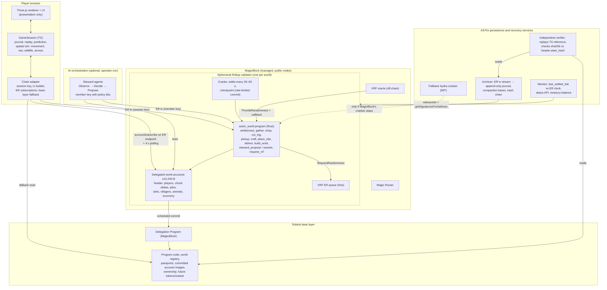

# ASTrix on MagicBlock: architecture proposal

**Check date: 2026-11-26.** Research synthesis only. Nothing was deployed, funded, signed or changed in `/projects/sandbox/Astrix`. This document adds no new facts about MagicBlock. Every fact is taken from the five research documents below, or from ASTrix files read on 2026-11-26 (repo HEAD `aad7660`), and keeps their evidence labels.

## Sources and labels

| Key | Document |
|---|---|
| ARCH | [MagicBlock_Architecture_Research.md](MagicBlock_Architecture_Research.md) |
| MGD | [MagicBlock_Managed_vs_Self_Operated_Infrastructure.md](MagicBlock_Managed_vs_Self_Operated_Infrastructure.md) |
| TICK | [MagicBlock_Scheduled_Tasks_and_World_Ticks.md](MagicBlock_Scheduled_Tasks_and_World_Ticks.md) |
| VRF | [MagicBlock_VRF_and_Deterministic_World_Generation.md](MagicBlock_VRF_and_Deterministic_World_Generation.md) |
| REPL | [MagicBlock_Replication_Persistence_Recovery.md](MagicBlock_Replication_Persistence_Recovery.md) |
| AX | ASTrix, read-only, paths relative to `/projects/sandbox/Astrix/` |

| Label | Meaning |
|---|---|
| **[Doc]** | Documented by MagicBlock or Solana |
| **[Src]** | Verified in source code |
| **[Ex]** | Demonstrated: an example, ASTrix devnet evidence, or a live read-only check |
| **[Bench]** | Measured (ASTrix's own evidence; no independent MagicBlock benchmark exists) |
| **[Inf]** | Architectural inference. This whole proposal is [Inf] unless a line says otherwise |
| **[Est]** | Estimate calculated from cited inputs |
| **[Unk]** | Unknown; see [MagicBlock_Open_Questions_for_Engineering_Team.md](MagicBlock_Open_Questions_for_Engineering_Team.md) |

---

## 1. Facts this design must respect

| # | Fact | Label and source |
|---|---|---|
| F1 | MagicBlock validators run only Solana SBF programs and native built-ins. There is no TypeScript, JavaScript or WASM runtime. | [Src][Doc] ARCH §1, §3.3 |
| F2 | A "rollup" is a delegation of accounts to one shared, named validator. Only that validator can commit or undelegate them. | [Src] ARCH §5.1; MGD §0 |
| F3 | The validator, Delegation Program (DLP) and VRF code are BSL-1.1 with no production grant until 2027-12-01. Commits need a fees vault that only MagicBlock's DLP authority can create, so self-hosting needs MagicBlock's permission. | [Src] MGD §0, §B.6 |
| F4 | Validators never commit automatically. The program must schedule every commit. | [Doc][Src] ARCH §8; REPL §1.5 |
| F5 | Accounts over 10,240 bytes cannot be committed to Solana. | [Doc] ARCH §11; REPL §3.1 |
| F6 | ER transactions cost 0; delegation sessions 0.003 SOL; each commit after the first 0.001 SOL (live from commit 26 with a fee payer). | [Doc] ARCH §8; REPL §4.1 |
| F7 | DLP v1 accepts a commit if the named validator signed it. No fraud proof or challenge runs in the deployed program. | [Src] ARCH §6; REPL §1.1 |
| F8 | Scheduled tasks are best-effort timers. Two schedulers are live (1.1.1 in-validator, 2.x Hydra with an external cranker). Missed runs replay back to back. ASTrix's clock-gated `tick` loses world time after an outage. | [Src] TICK §1.4, §2.1 |
| F9 | Crank budgets are about 400k CU (1.1.1) or about 87k CU per world in a 16-world Hydra crank. The full ASTrix tick (wildlife and navigation) does not fit one 1.4M CU transaction. | [Inf from Src/Bench] TICK §1.6, §2.2 |
| F10 | VRF proofs are verified on chain before the callback. The ER queue is free. Requests expire after 120 s with no refund and no notice. The callback shares a 300k/400k CU budget. | [Src][Doc] VRF §1.6–1.9 |
| F11 | No RTO or RPO is documented. ER state lives on one validator's disk. Replication is same-operator only. The escape hatch (request undelegation, then rollback to the last commit after 9,000 slots) exists in DLP source and is not wired into ASTrix. | [Src][Unk] REPL §1.1–1.8 |
| F12 | ASTrix's devnet program `Gge4…GRdy` ticks via cranker `8hwzNBBP…` (not ASTrix's key). The original crank is expected to run out around 2026-11-28 ~16:40 UTC. | [Ex][Inf] ARCH §13 |
| F13 | ASTrix's prospect callback is not bound to a request nonce, and the world seed is chosen by the caller. | [Src] VRF §2.1 |
| F14 | Wild-command reach is checked from a position the client reports. The position "is reported, not proven". | [Src] AX `Game/src/app/wild-commands.ts` L52-57 |

## 2. ASTrix principles and what each one forces

| Principle | Consequence in this architecture |
|---|---|
| The simulation is authoritative | There are two authoritative simulations, each for its own domain. The Rust program is authoritative for the **shared economic tier**: anything other players depend on, anything that can be traded, and anything contested. The TS `GameSession` stays authoritative for local-only worlds and for spatial behaviour (movement, navigation, wildlife minds, arrow physics), as it is today (AX `MagicBlock_Architecture_2026-11-23.md` §8). Each fact has exactly one authority. |
| The renderer only renders | Three.js reads sim state (local) or chain state mirrored into the sim. It never writes to the chain and never decides an outcome. Unchanged from today. |
| Agents propose, they do not invent outcomes | Steward agents submit commands. The program (on chain) or `GameSession` (locally) computes the result. An agent key cannot hold any permission beyond its policy bits (§8). |
| Resources have identity, quantity, location and lifecycle, and can be reserved | Every on-chain resource is an addressable record: a generated id plus a tombstone or remaining count, a pile record, or an inventory slot. Reservations move into the program as escrow counts (§6). |
| Construction consumes delivered materials | A site record holds delivered counts. Delivery debits the source in the same transaction (REPL §2.4 item 4). Work progress cannot pass what has been delivered. |
| Animals have persistent identity and independent behaviour | Identity, health and death are on chain (record plus a monotonic death bitmap). Behaviour stays in deterministic TS (REPL §4.4; TICK §2.3). |
| Deterministic where reproducibility is needed | Generation stays seed-based and client-side. On-chain rules use integer math only. A Rust/TS equivalence test is part of every ported rule (TICK §2.2 determinism risks). VRF output is a journaled input (VRF §3.3). |
| Migrations never destroy saves | Chain attachment is opt-in and additive. Local saves keep their bytes. The current devnet worlds are never reset or re-seeded (§13). |

## 3. Authority model: the choice and its trust cost

Two designs hide behind "built on MagicBlock" (ARCH §12.1):

| | **A. Server-key authority** | **B. Rule-enforcing program** |
|---|---|---|
| Who computes the next state | An ASTrix server running the TS sim | The Rust program on the ER |
| What the chain checks | Signatures, caps, rate limits. It cannot check a rule it did not run. | The rule itself |
| What a player must trust | The ASTrix server key, plus MagicBlock for ordering, liveness and commits | MagicBlock's validator for ordering, liveness and honest commits (DLP v1 has no fraud proof, F7). The program upgrade authority, because it can change the rules. |
| What MagicBlock adds | A fast, ordered public log and commits to Solana. A notary. | Rule enforcement, fair VRF, and ticks without an ASTrix server |
| Rust porting work | None | Every enforced rule |
| Fits the "world runs without you" goal | Only while ASTrix's server runs | Yes, while MagicBlock's validator and cranker run |

**Recommendation: B for the shared economic tier, local TS for the rest, and A for nothing.** [Inf]

- Design A adds a trusted ASTrix server and keeps all the MagicBlock trust as well. It costs more trust than a normal game server and gains little.
- Design B still trusts the MagicBlock validator, and players should be told so (ARCH §6). Running our own validator does not remove that trust; it moves it to ASTrix (MGD §E.2).
- Three trust limits remain under B and must be stated in the product:
  1. **Reported position.** The program cannot verify where an avatar stands, because movement is not simulated on chain (F14). Reach checks are bounded plausibility checks: the reported position must be within the maximum speed times the elapsed time from the last accepted position. They are not proofs.
  2. **Generated facts.** The program cannot run the terrain generator (F9). Generated resources are validated against a committed root (§6.2), so cheating is detectable by anyone, but it is prevented only where the root is correct.
  3. **Upgrade authority.** Whoever holds the program upgrade key can change the rules. Keep it with the owner, publish program hashes, and later move it to a multisig.

## 4. Components



### 4.1 Role of each component

| Component | Does | Never does | Evidence |
|---|---|---|---|
| **Three.js client** | Renders `GameSession` state, including chain-derived state mirrored into it. Animates outcomes (tree fall, villager walk) after they are known. | Decide outcomes; write to the chain; depend on the chain to run | AX `MagicBlock_Architecture_2026-11-23.md` §8 owner decision |
| **ASTrix TS simulation** | Local authority for offline and local-only worlds. Prediction for chain worlds. Spatial simulation: movement, nav, wildlife minds, hunting physics. Equivalence oracle for every ported rule. | Override a chain verdict. When the program rejects a command, the predicted effect is rolled back. | AX `Game/src/app/session.ts` (single write boundary, L1-2) |
| **MagicBlock program (Rust)** | Enforces the shared economic rules in §5.1. Lazy `settle(now)`. Escrow, tombstones, sequence numbers, VRF callbacks, checkpoint scheduling. | Spatial simulation, terrain generation, per-tick AI | F1, F9 |
| **Ephemeral Rollup** | Orders and executes every write to a world's accounts, at 0 fee and ~10 ms slots. Holds live state. Runs cranks. | Guarantee durability beyond its disk; commit on its own | F4, F11; ARCH §7 |
| **Solana** | Program code, registry, passports, durable committed images, ownership. Later: tokens, market, achievements. | Hold history (commit PDAs are closed at finalize) | REPL §1.6 |
| **AI orchestration** | Steward agents observe state, decide and propose bounded commands under a policy set by the owner (§8). | Hold owner authority; produce outcomes | AX `Game/src/sim/homestead.ts` L3927-3990 |
| **Archiver / checkpoints** | Keeps ASTrix's own history. The ER ledger is bounded and is not an archive ASTrix controls. | Act as an authority. A restore re-applies archived commands only through program validation. | REPL §1.6, §2.5 |
| **Networking** | Client subscribes to the ER endpoint from `getDelegationStatus`. The router WebSocket supports only `signatureSubscribe`. | Use the router for account subscriptions or `getProgramAccounts` | ARCH §9 |

## 5. The pipeline across components

The local pipeline exists today: UI and agents observe; commands and steward `propose`/`permitted` propose and authorize; sim rules plus `validateCommand` execute and verify; the journal and hash record (AX `Wilderness_Architecture_2026-11-25.md` §1). In a chain world each step has a fixed home:

| Step | Local-only world (today) | Chain world (proposed) |
|---|---|---|
| **Observe** | UI and steward read `GameSession` state | Client and agents read ER accounts through subscriptions and polling. Fallback: committed images on Solana. |
| **Decide** | Player input; steward rules | Same, off-chain. The program never sees intentions, only commands. |
| **Propose** | `dispatch(command)` with `id`, `expectedRevision` | ER transaction with `(player, seq, command_id)`. The TS sim predicts the result immediately, marked *pending*. |
| **Authorize** | `permitted(h, actor, action)`; `LocalAuthorizer` | Program `authorise(signer, required_bit)`: owner, live session key, or member with the right policy bits (AX `Identity_and_Persistence_Architecture_2026-11-24.md` §9 design) |
| **Execute** | Sim rule in TS | Rust rule on the ER, after `settle(now)` |
| **Verify** | `validateCommand`; outcome agreement (`wildAgrees`) | Program invariants (conservation, escrow, tombstones, caps). Client compares the ER outcome with its prediction. A mismatch is an equivalence bug and is logged. |
| **Record** | Journal entry `{command, sequence, revision, hash, outcome}` | The ER transaction is the record. The archiver appends it to ASTrix's journal. The local journal records a `chain_result` entry (same shape as the `vrf_result` entry in VRF §3.3), so replay reads results and never re-asks the chain. Durable on Solana at the next commit. |

## 6. Rules: what moves to Rust, what stays in TS

### 6.1 Placement per rule

| Rule | Ported to Rust and enforced on chain | Stays in TS, with an on-chain commitment | Stays in TS only (presentation or local) |
|---|---|---|---|
| Inventory, counts, capacity, tool durability | ✔ | | |
| Pickup collection (branch, stone, fibre) | ✔ tombstone or remaining count per generated id; capacity | Existence and quantity of the generated pickup: checked against a chunk root (§6.2) | Placement generation |
| Tree damage, fall, stump, trunk, log count | ✔ HP from (species, stage) table, swing cooldown, axe durability, `cutSwings`, log count from the timber rule | Tree existence, species and stage at epoch, via chunk root | Fall direction animation, shake |
| Tree regrowth, stump rot | ✔ lazy: `regrow_due_tick` compared with `world_tick` | | Visual growth stages |
| Crafting and recipes | ✔ recipe table, station requirement, exactly-once job record | | Craft menu |
| Reservations and construction | ✔ escrow counts per site, delivery debits source, `build_work` bounded by delivered materials | Placement legality (slope, water, overlap): TS checks; program checks footprint overlap with other on-chain sites only | Construction stage meshes |
| Villager jobs and production | ✔ job state machine; lazy production `min(floor(due/job_ticks), inputs, cap)` | Travel time per job: TS computes; program enforces a floor of straight-line distance ÷ max speed | Walking, A* paths, animation |
| Animal identity, health, death | ✔ record, health, death bitmap that is never cleared within a generation | Initial population from the seed (chunk root) | Movement, perception, chases, herd behaviour |
| Hunting | ✔ butcher yields, carcass record, single-death rule | Arrow hit: TS physics (deterministic); the program accepts a hit claim bounded by range and the target's last known position | Arrow flight |
| World time | ✔ `world_tick = f(ER clock)`, monotonic, capped settle | | Day/night visuals |
| Valuable randomness | ✔ VRF request and nonce-bound callback | | |
| Weather, seasons | ✔ only if they affect the economy: epoch seed by VRF (VRF §3.4) | | Visuals |
| Ownership, membership, sessions | ✔ (already, AX `chain/programs/astrix-settlement/src/lib.rs` L144-161, L438-457) | | |
| Terrain, meshes, water, camera, UI | | | ✔ |

Rule of thumb [Inf]: a rule goes to Rust when its outcome changes a count another player can see, trade or contest. Spatial facts stay in TS and reach the chain as bounded claims.

### 6.2 How the program knows a generated resource is real

The program cannot run the generator (F9). Three options, all [Inf]:

| Option | How | Trust | Cost |
|---|---|---|---|
| **a. Chunk roots** (recommended for the prototype) | For each chunk, a Merkle root over its generated resources `(id, kind, quantity, x, z)`. The first player to touch a chunk submits the root; the program stores it in the chunk-delta account. Every `gather` carries a Merkle proof. | Anyone can recompute the root from (seed, generator) and publish a mismatch. Prevention needs a challenge window or an attester (the owner, or a quorum of clients). | One 32-byte root per touched chunk. Proof verification is a few SHA-256 calls; CU must be measured (Prototype Plan P2). |
| b. Precomputed lists at genesis | The owner commits all roots at world creation. | Trust the creator once. Rejected for worlds that grow without bounds. | Heavy at genesis |
| c. Port a cut-down generator to Rust | The program recomputes the resource from (seed, id). | No trust needed | Feasible only for very simple fields, and needs bit-exact equivalence with TS, including the `Math.sin`/`localeCompare` risks (TICK §2.2) |

ARCH §12.2 lists the same family (node lists, Merkle commitments, edit-delta accounts).

### 6.3 Account layout

Use the layout estimated in REPL §2.2: about 33 accounts per world for 10,000 trees, 500 animals, 100 villagers, 300 buildings and 8 players. That is a header, one account per player, regional tree/chunk delta accounts, animal, villager, site and pile accounts, and an economy account. Every account is ≤ 10,240 B, uses fixed-width binary records, and carries `(world_id, schema, rules_version, generator, state_epoch)` [Est]. The header is not in the write set of ordinary actions, so players do not serialize on it (REPL §3.2).

## 7. Transaction flows

Common rules for all three flows [Inf, from REPL §2.4]:
- Every instruction calls `settle(now)` first, then requires `seq == player.last_seq + 1`. A repeated `(seq, command_id)` returns success with no state change. ER signature dedupe is not relied on, because it is empty after a leader restart (REPL §1.4).
- The client sends to the ER endpoint for the world's validator, with a session key (as today).
- Commit policy: strategy C from REPL §4.2 (header hash hourly, all dirty accounts daily, forced commit on ownership change).

### 7.1 Flow 1: player gathers a branch

```mermaid
sequenceDiagram
  participant U as Player
  participant TS as GameSession (browser)
  participant ER as astrix_world on ER
  participant O as Other players
  participant S as Solana
  U->>TS: tap branch p:cx,cz:i
  TS->>TS: validate locally (reach, capacity), predict: bag+1, pickup hidden (pending)
  TS->>ER: gather(p_id, proof, at, seq, cmd_id)
  ER->>ER: settle(now); authorise; seq check; chunk root + proof; tombstone bit clear; reach plausibility; capacity
  ER-->>TS: ok (sig) / error (AlreadyTaken, OutOfReach, BagFull…)
  TS->>TS: ok: journal chain_result; error: roll back prediction
  ER-->>O: accountSubscribe(chunk delta, player): pickup gone
  Note over ER,S: next checkpoint commits dirty chunk + player accounts
```

| Question | Answer |
|---|---|
| Executes locally | Reach and capacity pre-check, prediction, rendering, Merkle proof built from the local generator |
| Executes on MagicBlock | `gather`: authorisation, sequence, proof against the stored chunk root, tombstone, capacity, inventory credit. About 0 fee (F6). |
| Stored (ER) | Tombstone bit in the chunk-delta account; bag count in the player account; `last_seq` |
| Committed to Solana | At the next checkpoint, as part of the dirty set. Not per gather. |
| Others observe | The chunk-delta account change through their ER subscription; the pickup disappears from their render. Their own TS sim applies the tombstone. |
| Two players at once | Writes to the chunk account serialize in arrival order (ARCH §7). The second `gather` fails `AlreadyTaken`, and that client rolls back its prediction. |
| Failure and replay | Transaction lost or timed out: the client resends the same `(seq, cmd_id)`. If it had landed, the resend is a no-op. ER down: the command stays pending locally and is not recorded as accepted. Crash tail lost (R1): the client resubmits pending commands; the sequence rule rejects duplicates. Rollback to the last commit (R2): `state_epoch` increments, and clients re-sync from the committed images (REPL §2.5). |

### 7.2 Flow 2: player chops a tree and makes logs

| Step | Local | MagicBlock (ER) | Stored | Notes |
|---|---|---|---|---|
| Each swing | Swing animation, predicted damage | `chop(tree_id, proof, at, seq)`: axe equipped and durable, reach plausible, cooldown ≥ `SWING_COOLDOWN_MS` (650 ms) and ≤ `SWINGS_PER_TICK` (4), tree standing. HP −1, durability −1. | Tree delta record `{id, stage, damage, remaining, regrow_due_tick}` (REPL §2.2); axe durability in the player account | Constants from AX `Game/src/sim/felling.ts` L50-63. One transaction per swing is affordable because ER fees are 0, but it multiplies ER load. Batching swings (`chop{n}`) is a prototype option [Inf]. |
| HP reaches 0 | Fall animation, played after the confirmation | Same transaction: the tree becomes a stump, `regrow_due_tick` is set from the lifecycle table, and a trunk record `t:N` is created with deterministic orientation | Trunk record (capped, as `MAX_TRUNKS` = 256) | The fall is decided on chain. The render only plays it. |
| `cut_log` swings | Animation | `cutSwings(trunk)` swings per log, log count from the species/stage timber rule; creates a pile record `{id, item: log, n, x, z}` | Pile account | Logs have identity (pile id), quantity, location and lifecycle |
| `pickup` logs | Carry pose | Debits the pile and credits the bag in one transaction, within carry capacity | Pile, player | Conservation: pile − n = bag + n |
| Regrowth | Visual stage | Lazy in `settle`; no crank per tree | Tree delta only | TICK §2.3 |

- **Committed to Solana:** tree delta, trunk, pile and player accounts at the next checkpoint. A felled tree is not committed on its own.
- **Others observe:** shake and fall from the tree-delta change; the trunk and piles from the pile account.
- **Failure and replay:** each swing is its own transaction. If the ER stops mid-chop, the confirmed damage stays on the ER and unconfirmed swings are resent with their sequence numbers. After R2, damage since the last commit is lost; the tree is standing again in the committed image, and `state_epoch` tells clients to re-sync. Players can repeat the work, and no logs are duplicated, because logs exist only in committed or ER records.

### 7.3 Flow 3: a villager gathers and builds while the player is offline

```mermaid
sequenceDiagram
  participant P as Player (offline)
  participant SA as Steward agent (optional)
  participant CR as settle crank (every 60 s)
  participant ER as astrix_world on ER
  participant S as Solana
  Note over P: before leaving: approve_site (materials reserved), assign villager job
  CR->>ER: settle(group of ≤16 worlds)
  ER->>ER: due = min(world_tick(now) − last_settled, MAX_SETTLE_TICKS)
  ER->>ER: job: trips = floor(due / trip_ticks); moved = min(trips × carry, source free, site need)
  ER->>ER: debit source, credit site escrow; build_work += min(rate × due, delivered-limited)
  ER->>ER: completion event (budget 16/call) → building record, escrow consumed
  SA->>ER: steward_propose(next site) [policy 'approve'] or assign job [policy 'auto']
  Note over ER,S: checkpoint crank: header hash hourly, dirty set daily, forced on completion
  P->>ER: returns: reads accounts
  P->>P: TS animates villagers to positions consistent with the on-chain result
```

| Question | Answer |
|---|---|
| Executes locally | Nothing while the player is offline. When the player returns, the TS sim reconciles: it places villagers and animates the work that the chain already decided (presentation). |
| Executes on MagicBlock | `settle(now)` from the crank or from any instruction: closed-form job progress, escrow delivery, construction progress and completion events, each with a per-call budget (TICK §4.3). Steward proposals and approvals as normal instructions. |
| Stored (ER) | Villager job record `{id, state, source, site, trip_ticks, carried}`; site escrow counts; economy totals; header `last_settled_tick` |
| Committed to Solana | Dirty set daily, plus a forced commit when a building completes [Inf: a completed building is an asset worth making durable] |
| Others observe | Members subscribed to the world see site progress and completion through ER account changes |
| Where travel time comes from | When the job is assigned, the TS sim computes the trip time from its A* route. The program accepts it only if it is at least straight-line distance ÷ max villager speed. A client can make a villager slower, never faster than physics allows. |
| Failure and replay | Crank missed or late: the next `settle` catches up, because world time comes from the ER clock, not from crank count. Nothing is lost up to `MAX_SETTLE_TICKS` per call (TICK §4.2). Cranker gone: `settle` is permissionless, so ASTrix's own `hydra-cranker` or any client can drive it (TICK §4.4). Validator down: the world pauses and continues on return. R2 rollback: the job resumes from the committed state, `state_epoch` increments. Idempotence: `last_settled_tick` is monotonic, so a second `settle` at the same `now` does nothing. |
| Offline policy | Owner decision: full progression, capped hours, or reduced rate. The mechanism supports all three (TICK §4.3 item 6). |

This replaces today's 2 s `tick` crank, which loses world time after outages (F8) and cannot grow to a real world tick (F9).

## 8. AI orchestration (steward agents)

- **Today:** stewards are an `Actor` with a per-action `Policy` of `auto`, `approve` or `off`. `propose` creates a proposal; the owner's `resolve_proposal` executes it as the owner's decision (AX `Game/src/sim/homestead.ts` L3924-3990).
- **On chain:** a steward is a member key with restricted permission bits and its own action budget, as designed in AX `Identity_and_Persistence_Architecture_2026-11-24.md` §9. The program enforces `policy[action]`: `auto` executes, `approve` stores a proposal record, `off` rejects. Every action is attributed to its signer.
- **Pipeline:** the agent observes ER state, decides off-chain (a rule engine or a model), and proposes a transaction. The program authorizes against policy bits, executes the rule and verifies invariants. The ER transaction records it. The agent cannot create an outcome. It can only choose which permitted command to send and when.
- **Trust and custody:** an operator-run agent holds a member key on a server. That is a new hot key and an escalation point that needs owner approval, like the reserve-replenishment job (AX Identity doc §6). The owner can revoke the key at any time.
- **Limit:** an agent that sends many commands competes with players for the world's write locks. Keep agent budgets small and use lazy jobs (§7.3) instead of per-step commands.

## 9. Persistence and recovery services

Taken from REPL §2.5 and §2.6 [Inf]:

| Service | Job | Notes |
|---|---|---|
| Checkpoint crank | sha256 over the canonical concatenation of world accounts → `header.state_hash`, `journal_seq`, `world_tick`; commits header hourly and the dirty set daily | Generalises today's `checkpoint` (AX `lib.rs` L461-490). Treasury PDA pays. |
| Archiver | Subscribes to ER program transactions plus `getSignaturesForAddress` backfill; appends `(sig, slot, instruction, player, seq, command_id, post-state hash)` in the existing journal format | The ER ledger is bounded (100 GiB default, oldest 10% pruned; REPL §1.2) |
| Independent verifier | Replays from the last compaction base with the TS reference rules; checks hashes against the archive and the Solana committed images | Runs with public RPC only |
| Monitor | Alerts when `world_tick(now) − last_settled_tick` grows, on status API `er` down, on treasury balance | The scheduler gives no failure callback (TICK §4.4) |
| Escape-hatch wrappers | New program instructions `request_undelegation` and `rollback_after_timeout`, which save and restore data around the DLP call | Not in ASTrix today (REPL §1.7). Needs a program upgrade. |
| Restore (optional) | Admin-multisig `restore` re-applies archived commands after a rollback, only through program validation, and only if the resulting hash matches the archive | Re-trusts the archive (REPL §2.5) |

Recovery cases:
- **R1, validator restarts with its disk:** compare the ER header `(epoch, tick, journal_seq)` with the archive. If the ER is behind (crash tail), clients resubmit and the sequence rule drops duplicates.
- **R2, validator lost or out for longer than T (for example 15–30 min):** request undelegation. After 9,000 slots (about 60 minutes at 400 ms), roll back to the last commit and increment `state_epoch`. Optionally restore, then re-delegate to another region.
- **Rough RPO [Est]:** R1 is the crash tail [Unk]. R2 without restore is up to one full-commit interval (24 h at strategy C). R2 with restore is archiver lag. **Rough RTO [Est]:** R2 is at least T + 9,000 slots + base-layer transactions (REPL §2.5).

What survives a validator loss in this design: ownership (always committed), the last committed images, ASTrix's archive, and every local save. What is lost without a restore: ER activity after the last commit.

## 10. Networking and subscriptions

From ARCH §9 and AX `Identity_and_Persistence_Architecture_2026-11-24.md` §4:
- Find the world's ER endpoint with `getDelegationStatus`. Subscribe with `accountSubscribe` on that ER endpoint (WebSocket = HTTP port + 1). The router WebSocket only supports `signatureSubscribe`.
- Subscription queues are bounded and slow clients are disconnected, so keep the 4 s polling backstop ASTrix already uses and re-read after every reconnect.
- The router rejects `getProgramAccounts`; the ER ignores `dataSize` filters. Find accounts by memcmp plus a length check, as ASTrix does now.
- Subscribe only to accounts near the player: their own player account, chunk deltas in view, sites and piles in view, and the header. Account-per-region layout (§6.3) makes this a short list.
- Live positions of other players: a presentation-only feed. An ER-only Magic account per player for coarse positions is possible: it never commits and is lost if the validator loses it (ARCH §11). That is acceptable for positions (REPL §2.3).
- Base-layer fallback when the ER is unreachable: read committed images on Solana and check `sha256(world) == passport.state_hash` (already implemented).

## 11. Partitioning (Part 6)

From REPL §3.2 [Inf]:

| Decision | Recommendation |
|---|---|
| Unit of delegation | **One ER per world.** All of a world's ~33 accounts sit on one validator, so actions across villagers, stock and sites stay atomic. |
| Growth | **Many worlds per validator, spread over regions** (`MEUGG…` for EU, `MUS3…` for US). Worlds are independent, so each can be placed near its players. Capacity limits per validator are [Unk]. |
| Inside a world | Partition accounts by player and by region/chunk range so independent players write independent accounts. Keep the header out of ordinary write sets. |
| Per-region ERs inside one world | Only for very large worlds, with borders as portals and escrow tickets. No atomic transaction across validators (ARCH §12.5). |
| Per-system ERs | **Reject.** Systems interact every tick. |
| Cross-world transfers | Outbox record → commit → base-layer ticket → destination program credits once by `transfer_id` (REPL §3.3). Magic Actions are not atomic with the commit, so every step must be idempotent. |
| Global state | Ownership, tokens, market and achievements on Solana (hybrid, AX `MagicBlock_Architecture_2026-11-23.md` §2) |

## 12. Activity split: on chain, rollup, presentation (Part 7)

Placement is [Inf]; costs are from REPL §4.1–4.4 [Doc/Est]. "ER" = executed on the rollup and committed in the checkpoint batch. "Base" = a Solana transaction.

| Activity | Placement | Marginal cost | Cost reference |
|---|---|---|---|
| Player movement | Presentation; optional ER-only position for nearby players | 0 | REPL §4.4 row "Player movement" |
| Gathering pickups | ER (`gather`), chunk root plus tombstone | 0 per action; share of the daily dirty commit | REPL §4.4 "Gathering" |
| Felling and log cutting | ER per swing (or batched) | 0 per action | REPL §4.4 "Tree lifecycle" |
| Tree regrowth | ER, lazy in `settle` | 0 | REPL §4.4 |
| Crafting | ER with job record | 0 | REPL §4.4 "Crafting" |
| Construction | ER, escrow; forced commit on completion | 0 + 0.001 SOL per committed account after commit 25 | REPL §4.1 live commit fee |
| Villager jobs | ER, lazy `settle` driven by a 30–60 s crank | 0 in fees; crank capacity [Unk] | REPL §4.4 "Villager simulation"; TICK §4.4 |
| Villager movement | Presentation (TS nav) | 0 | TICK §2.3 |
| Animal behaviour | Off-chain deterministic TS | 0 | REPL §4.4 "Animal simulation" |
| Animal identity, health, death | ER, death bitmap | 0 | REPL §2.3 |
| Hunting shot | TS physics; ER accepts the bounded hit claim and the butcher yield | 0 | VRF §2.2 "Hunt and fishing hits" |
| World time | ER clock in `settle` | 0 | TICK §4.2 |
| Checkpoints | ER commit via crank | Strategy C ≤ 0.057 SOL/day per world (33 accounts); ASTrix today 0.048 SOL/day per world (2 accounts hourly) | REPL §4.2 |
| Discovery randomness (prospect, loot, rare births) | ER VRF queue | Free; base queue 0.0005–0.0008 SOL | VRF §1.8; REPL §4.1 |
| World genesis seed | VRF genesis on ER queue | Free | VRF §3.2 option A |
| Ownership, transfers, claims | Base + forced commit | 5,000 lamports per signature + priority fee | REPL §4.4 |
| Tokens, market, achievements | Base | Solana fees | REPL §4.4 |
| Terrain, meshes, water, weather visuals, UI | Presentation | 0 | ARCH §12.2 |

Per-world one-off and locked costs [Est, REPL §4.2–4.3]: rent ≈ 1.34 SOL refundable at 5,080 lamports/byte (≈ 0.18 SOL at the planned 696); delegation deposits ≈ 0.10 SOL per session, effectively consumed; at 25 worlds, ≤ 1.4 SOL/day of commit fees with strategy C against 19.8 SOL/day with strategy A. Keeping bulky rebuildable state (tree deltas, animal positions) in Ephemeral accounts cuts rent from 52.7M to 329,600 lamports per 10 KB account, but makes R2 recovery of that state depend entirely on ASTrix's archive (REPL §4.2).

## 13. Migration without destroying saves

### 13.1 Local saves (browser)

Local saves use one Web Storage key per world with schema-versioned save records (AX `Game/src/app/persistence.ts` L1-12). Old schemas keep their bytes, and upgrades are journaled commands (REPL §2.1). Fixture tests pin this: 165/165 passed in the W5–W8 pass (AX `13_Integration_and_QA/Evidence/W5-W8/FINAL-REPORT.md`).

| Step | What happens | Save safety |
|---|---|---|
| M0 | Nothing changes. Local worlds remain fully playable offline. The game runs without the chain. | No save touched |
| M1 | Chain worlds are a **new world type** in the world list, like the wilderness scenario (AX `Wilderness_Architecture_2026-11-25.md` §2). New save key, new journal field (e.g. `chain: {program, world, epoch}`), omitted for local worlds so their bytes and hashes stay identical. | Exact-hash fixture tests for every existing save |
| M2 | Optional **attach**: a journaled `chain_attach` command records the local snapshot hash and creates a chain world whose genesis carries that hash. Only what the program can validate moves: counts within caps and recipe-reachable inventories. Placed buildings and generated deltas are re-proposed as normal commands. | The local save is kept unchanged as a read-only "pre-attach" copy. Nothing is deleted. Owner decision before it is built, because it touches identity and ownership (AX Wilderness doc §2). |
| M3 | Chain worlds keep a local journal of `chain_result` entries, so offline viewing and replay still work | Replay never re-calls the chain |

### 13.2 The existing devnet settlement (`Gge4…GRdy`)

| Item | Proposal | Needs owner approval |
|---|---|---|
| Live program and 32 worlds | Leave untouched. Do not reset, re-seed or move any claimed world. The prototype uses a **separate program id and separate accounts** (Prototype Plan). | — |
| Tick crank expiry (~2026-11-28 ~16:40 UTC for the original task 742001; expiry of slot cranks 742101/742117 not established here) | Option 1: let it lapse. Because `tick` is clock-gated, the world pauses; state stays on the ER and on Solana at the last checkpoint [Inf]. Option 2: re-schedule with the admin key. Behaviour at exhaustion is untested (ARCH §13), so observe and record it either way. | Yes, any devnet transaction |
| Checkpoint cranks (1,000,000 iterations) | Keep. They protect the base-layer copy. | — |
| Program fixes (prospect nonce, cancel deadline, escape-hatch wrappers, VRF genesis) | Ship in the new program first. Upgrade `Gge4…` only if the owner wants the hackathon worlds to continue. The upgrade must keep account layouts, as the 2026-11-24 migration did (AX Identity doc §7). | Yes |
| Moving a world to the new program | Not possible in place: the account owner is the old program. Path: commit and undelegate the old world, then the owner signs a `link_legacy` on the new program that records the old world address and its `state_hash`. The old account stays on Solana as the historical record. | Yes |
| Mainnet | Mainnet runs validator 1.1.1 with the older crank model. Re-test cranks and commits there before any move (MGD §E.5). | Yes, and it spends real SOL |

## 14. Open risks of this proposal

- CU fit of `settle`, Merkle verification and `chop` is unmeasured [Unk]. The prototype measures it first.
- Rust/TS equivalence for every ported rule. Known hazards: `Math.sin`/`Math.cos`, floating `Math.sqrt`, `localeCompare` sorts (TICK §2.2).
- Reported positions and chunk roots are bounded trust, not proof (§3).
- Single-validator trust and the absence of an SLA, RTO and RPO (F7, F11; MGD §A.5).
- Public-node capacity limits are undocumented (ARCH §12.3).
- Licensing and whitelisting block self-hosting until MagicBlock agrees (F3).
- Devnet and mainnet run different validator lines (MGD §0.5).
