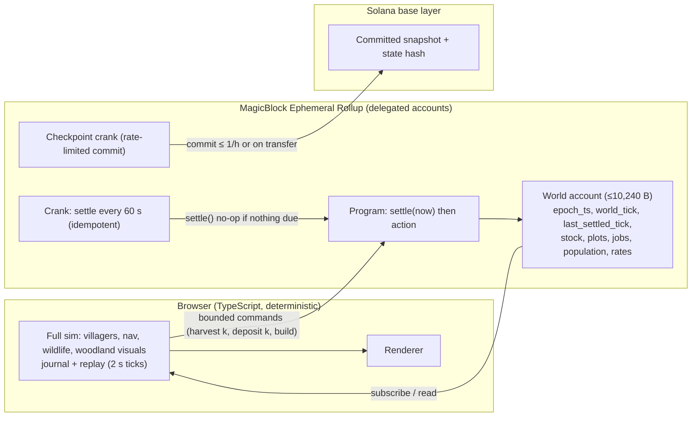

# MagicBlock scheduled tasks (cranks) and ASTrix world ticks

**Check date of every source below: 2026-11-26.** Research only. Nothing was deployed, no keys or accounts
were created, no transactions were sent, and no RPC call was made to any MagicBlock or Solana cluster.
ASTrix files were read, not modified. All text is paraphrased.

## Evidence labels

| Label | Meaning |
|---|---|
| **[DOC]** | Officially documented on docs.magicblock.gg (or the agave/Solana source for runtime constants) |
| **[SRC]** | Verified by reading source code at the pinned commit. Read, not executed |
| **[EX]** | Demonstrated in an example or in an ASTrix devnet evidence report |
| **[BENCH]** | Independently benchmarked (ASTrix evidence reports; no new measurements were taken) |
| **[INF]** | Architectural inference: my reasoning from the above, not a fact |
| **[UNK]** | Unknown. A question for MagicBlock is listed in §6 |

## Sources (all checked 2026-11-26)

| ID | Source | Version / commit |
|---|---|---|
| D1 | https://docs.magicblock.gg/pages/tools/crank/introduction.md | fetched copy: `research/magicblock/src/fetched-2026-11-26/intro.md` |
| D2 | https://docs.magicblock.gg/pages/tools/crank/implementation.md | copy: `src/fetched-2026-11-26/impl.md` |
| D3 | https://docs.magicblock.gg/pages/overview/additional-information/pricing.md | copy: `src/fetched-2026-11-26/pricing.md` |
| D4 | https://docs.magicblock.gg/pages/ephemeral-rollups-ers/introduction/fees-and-commit-economics.md | copy: `src/fetched-2026-11-26/fees.md` |
| D5 | https://docs.magicblock.gg/pages/ephemeral-rollups-ers/introduction/runtime-limits.md | copy: `src/fetched-2026-11-26/runtime-limits.md` |
| V1 | https://github.com/magicblock-labs/magicblock-validator/tree/v1.1.1 | tag v1.1.1 = `493729d`; clone `src/validator-v1.1.1/` |
| V2 | https://github.com/magicblock-labs/magicblock-validator (master, 2.x line) | `543fd3f` (2026-11-25); clone `src/validator-master/` |
| H | https://github.com/magicblock-labs/hydra | `7ee29e4` (2026-11-20); clone `src/hydra/` |
| S | https://github.com/magicblock-labs/ephemeral-rollups-sdk | `4545ccf` (2026-11-18); clone `src/ephemeral-rollups-sdk/` |
| A | agave crates `solana-program-runtime` 4.0.0, `solana-compute-budget-instruction` 4.0.0, `solana-builtins-default-costs` 4.0.0 (versions pinned in V1 `Cargo.lock`) | crates.io; extracted in `src/crates/` |
| E | `/projects/sandbox/.tools/magicblock-examples-main/crank-counter/anchor` | local copy |
| K | `/projects/sandbox/.tools/magicblock-dev-skill-main/skill/references/cranks.md` | skill VERSION 0.5.0 |
| X | ASTrix repo `/projects/sandbox/Astrix` (read-only) | `aad7660` (2026-11-26) |

Solana's own docs pages (solana.com/docs) returned a Vercel bot-check page and could not be read. Runtime
constants are therefore cited from the agave source (A) and from MagicBlock's runtime-limits page (D5).

---

## 1. Mechanics, with evidence

Two scheduler implementations are live at the same time, and ASTrix must know which one its ER runs:

- **Validator 1.1.1** has a scheduler built into the validator. D2 (note box) says mainnet ERs and
  devnet-eu/devnet-as run 1.1.1. **[DOC]**
- **Validator 2.x** forwards `ScheduleTask` into a **Hydra** crank account, and an external
  `hydra-cranker` process fires it. D2 says devnet-us runs 2.0. **[DOC]**
- **Conflict.** ASTrix's MB001 report recorded devnet-eu as `core 2.0.4` on 2026-11-24
  (`Astrix/13_Integration_and_QA/Evidence/MB001-devnet-20261124/REPORT.md:4`), and
  `Astrix/00_Project_Core/MagicBlock_Architecture_2026-11-23.md:126` says all three devnet ERs reported
  2.0.4. That contradicts D2. **[EX]** vs **[DOC]**. The mainnet version is **[UNK]**. Call
  `getVersion` before relying on either model.

### 1.1 Creation: instruction, accounts, payer

| Fact | Evidence | Label |
|---|---|---|
| A program CPIs `MagicBlockInstruction::ScheduleTask(ScheduleTaskArgs)` into the Magic program on the ER. The args are `task_id: i64`, `execution_interval_millis: i64`, `iterations: i64` and `instructions: Vec<Instruction>`. | V1 `magicblock-magic-program-api/src/args.rs:173-178`; `instruction.rs:129-132`; D2 | [SRC] [DOC] |
| Account 0 is the payer, who must sign. The payer becomes the task **authority**. | V1 `programs/magicblock/src/schedule_task/process_schedule_task.rs:22-64,102-108` | [SRC] |
| SDK wrapper: `ephemeral_rollups_sdk::crank::ScheduleCrankCpi` (needs feature `crank`). It is marked deprecated in favour of `crank::hydra::ephemeral::create`, but it is still the call that 1.1.1 and the 2.x forwarder accept. | S `rust/sdk/src/crank/legacy.rs:3,12-19`; `rust/pinocchio/src/crank/legacy.rs:143-146` | [SRC] |
| Example: `schedule_increment` builds the target instruction inside the program and CPIs with `ScheduleCrankCpi`. | E `programs/crank-counter/src/lib.rs:47-75` | [EX] |
| Validation on schedule: iterations ≥ 1. The interval must be from 1 ms to below `u32::MAX` ms (about 49.7 days). The instruction list must not be empty. Inner instructions may not have signers other than the crank-signer PDA. The crank signer may not be writable. The validator authority may not appear. Privileged Magic instructions are rejected. | V1 `process_schedule_task.rs:66-100`; `schedule_task/mod.rs:21-84` | [SRC] |
| 2.x rejects **any** signer meta in a scheduled instruction. | V2 `programs/magic-program/src/schedule_task/mod.rs:22`; K lines 236-239 | [SRC] |
| The transaction only *stashes a request*. The scheduler applies it asynchronously after the transaction commits, so a successful transaction does not prove that the task was registered. | V1 `process_schedule_task.rs:110-111` (`ExecutionTlsStash::register_task`); V1 `magicblock-task-scheduler/src/service.rs:232-245`; D2 warning box | [SRC] [DOC] |
| **Task-ID collisions (1.1.1).** IDs are validator-global. If another authority already holds an ID, the request is rejected later and the task never runs, even though the transaction succeeded. | V1 `service.rs:340-347`; D2 warning | [SRC] [DOC] |
| In 2.x, the crank PDA is `sha256(authority ‖ task_id)`, so IDs are namespaced per authority. | V2 `task-scheduler/src/crank.rs:7-19` | [SRC] |
| **Who pays.** The scheduling transaction is an ER transaction, and the ER base fee is 0. In 1.1.1 every execution transaction is signed and fee-paid by the **validator authority**. In 2.x the validator identity is the crank's sponsor and authority, with `priority_tip: 0`. | D3; V1 `magicblock-config/src/consts.rs:18` (`DEFAULT_BASE_FEE = 0`); V1 `service.rs:416-420`; V2 `crank.rs:60-72`, `service.rs:152,224-238` | [DOC] [SRC] |

### 1.2 Who triggers execution

| Model | Mechanism | Label |
|---|---|---|
| **1.1.1: validator-internal.** | A Tokio `DelayQueue` inside the validator pops due tasks, batches every task that is due at the same moment, and sends one transaction per task to the validator's own RPC. The transaction is `[Noop(counter), ExecuteCrank{authority, instructions}]`. `ExecuteCrank` checks the validator signature and then runs each scheduled instruction by `native_invoke` (a CPI) with the crank-signer PDA as signer. | V1 `service.rs:192-230,392-430`; `process_execute_task.rs:15-103` [SRC] |
| **2.x: external cranker.** | The validator only creates or cancels a Hydra crank account. Anyone can send `Trigger` followed by the stored instructions once `current_slot >= next_exec_slot`. The scheduled instructions run **top-level** (no CPI frame). `Trigger` checks them byte for byte against the template. | V2 `task-scheduler/src/service.rs:26-35,136-174`; V2 `magicblock_processor.rs:152-155` (ExecuteCrank removed); H `programs/hydra-ephemeral/src/processor/trigger.rs:25-98`; H README [SRC] |
| **Who runs the 2.x cranker?** | On devnet-eu, ASTrix's ticks were signed by `8hwzNBBP…`. That key is neither ASTrix's wallet nor the validator identity `MEUGG…`, and no ASTrix process was running. So a MagicBlock-operated cranker was active on devnet-eu on 2026-11-24. | `Evidence/MB001-devnet-20261124/REPORT.md:21,35-37` [EX]. Whether this is guaranteed on mainnet, and on which ERs: [UNK] |

**A recurring task is not a running game server.** **[SRC]/[INF]** Each execution is one ordinary,
bounded Solana transaction. It gets the CU, account and heap limits in §1.6 and has no memory between runs
except account data. Nothing runs between executions. The scheduler cannot observe off-chain data, and it
cannot loop until work is finished. A 2-second crank means one transaction every 2 s that runs
`tick()` from scratch against the accounts.

### 1.3 Timing, intervals, recurrence

| Fact | Evidence | Label |
|---|---|---|
| Recurring: runs `iterations` times at `execution_interval_millis`. The first run is immediate (queued with delay 0). | V1 `service.rs:354`; D2 execution flow (T+0, T+100 ms, T+200 ms) | [SRC] [DOC] |
| **Minimum interval (1.1.1).** The interval is clamped up to the config `min_interval`, default **10 ms**. Public node configs are [UNK]. | V1 `service.rs:332-334`; `magicblock-config/src/consts.rs:72` | [SRC] |
| **Minimum interval (2.x).** Rounded **up** to whole slots, at least 1. The default block time is 50 ms, so 2,000 ms becomes 40 slots. | V2 `task-scheduler/src/crank.rs:79-87`; V2 `config/src/consts.rs:47` | [SRC] |
| Maximum interval: below `u32::MAX` ms. | V1 `process_schedule_task.rs:76-85` | [SRC] |
| Infinite tasks. 2.x maps `iterations == i64::MAX` to Hydra's "forever" sentinel. 1.1.1 has no sentinel, but `i64::MAX` executions are effectively unbounded. | V2 `task-scheduler/src/service.rs:146-150`; H `crates/hydra-api/src/consts.rs:20-22` | [SRC] |
| **The schedule is anchored, not "now + interval".** 1.1.1 sets next = last_execution + interval. Hydra sets `next_exec_slot += interval_slots`. | V1 `service.rs:751-761` (`next_execution_millis`), `service.rs:641-652`; H `trigger.rs:85-96` | [SRC] |
| **Best-effort, not exact time.** 1.1.1 fires from the validator's wall clock and then submits through RPC. Hydra only refuses early triggers, and a cranker decides when to send. The docs and the skill both advise against depending on slot timing. | V1 `service.rs:203-226`; H `trigger.rs:58-60`; D5 note; K lines 26-27 | [SRC] [DOC] |
| Measured cadence: ASTrix's 2,000 ms crank advanced about 0.5 ticks/s on devnet-eu (10 ticks in 20 s). Jitter was not measured. | MB001 `REPORT.md:37` | [EX]; jitter [UNK] |

### 1.4 Failure, retries, missed executions, recovery

| Fact | Evidence | Label |
|---|---|---|
| **1.1.1 retries.** A failed send (an RPC error, which includes a failed preflight simulation) is retried up to **10** times, with backoff from max(slot, 100 ms) doubling up to 5 s. After that the task is moved to `failed_tasks` and **removed**: the schedule stops for good. Non-RPC errors are not retried. | V1 `service.rs:43-45,582-619,666-716,735-744,767-770` | [SRC] |
| "Success" in 1.1.1 means the RPC accepted the transaction. Preflight is on by default, so a deterministic program error usually surfaces as a failed send and a retry. An on-chain failure after preflight is not observed. | V1 `service.rs:421-426` | [SRC]; RPC default preflight behaviour [INF] |
| **2.x / Hydra.** A failed scheduled instruction reverts the whole trigger transaction, so `next_exec_slot` does not advance and the cranker backs off. A crank that stays overdue for about 10 days (`STALENESS_THRESHOLD_SLOTS`) becomes closable. | H README (atomicity); H `consts.rs:59-84`; H `crates/hydra-cranker/src/fire.rs:99-137` | [SRC] |
| **Missed executions are replayed, not coalesced.** The schedule is anchored (§1.3). After a validator stop or cranker outage, every missed interval becomes due at once, and the backlog drains as back-to-back executions. Each one **consumes an iteration**. | V1 `service.rs:172-185` (on restart: delay = max(next − now, 2 slots)), `service.rs:641-652`; H `trigger.rs:85-96` | [SRC] (logic read; not executed) |
| Exactly-once is not guaranteed. The application must make scheduled instructions idempotent or monotonic. | K lines 136-151; D2 warning | [DOC]-adjacent (MagicBlock skill) |
| Behaviour after `iterations` run out: the task is removed. Nobody renews it automatically. | V1 `service.rs:563-574`; H `trigger.rs:61-63` (`Exhausted`) | [SRC]; ASTrix has not tested this: MB001 `REPORT.md:67` |

### 1.5 Persistence, restart, unavailability, cancellation

| Fact | Evidence | Label |
|---|---|---|
| 1.1.1 persists tasks in a **SQLite** database on the validator host. On start they are reloaded and requeued. If the config `reset = true`, all tasks are wiped at startup. Failed records are kept 14 days. | V1 `service.rs:106-117,147-189`; `magicblock-config/src/config/scheduler.rs:10-24`; `consts.rs:73-76`; `magicblock-api/src/magic_validator.rs:450-458` | [SRC] |
| Whether public ERs run with `reset`, and whether a task survives a move to another validator or a region failover. | none | [UNK] |
| 2.x keeps the schedule in an on-ER Hydra crank account, so it lives in the ER's accounts DB. The scheduler service itself is stateless. | V2 `task-scheduler/src/service.rs:26-29` | [SRC]; durability across ER restarts [INF]/[UNK] |
| **Scheduler or cranker down: nothing runs.** There is no fallback executor. In 1.1.1 the missed backlog fires when the scheduler returns. In 2.x it fires when any cranker returns. | as above | [SRC] / [INF] |
| **Player offline: no effect.** Execution never needs the player's key or browser. | MB001 `REPORT.md:33-37` | [EX] |
| Cancel: `CancelTask { task_id }`, signed by the authority. It is asynchronous. In 1.1.1 a wrong-authority cancel is logged and ignored after the transaction has succeeded. In 2.x, cancelling a missing crank is a no-op. | V1 `process_cancel_task.rs:12-51`; V1 `service.rs:362-389`; V2 `service.rs:176-192` | [SRC] |
| Rescheduling the same ID by the same authority replaces the task (1.1.1: `service.rs:350-355`; 2.x: cancel + create in one transaction, `service.rs:164-169`). | as cited | [SRC] |

### 1.6 Limits per execution

| Limit | Value | Evidence | Label |
|---|---|---|---|
| CU per transaction, maximum | 1,400,000 | A `solana-program-runtime-4.0.0/src/execution_budget.rs:39`; D5 | [SRC] [DOC] |
| Default CU limit when there is no `SetComputeUnitLimit` | 200,000 per non-builtin top-level instruction (3,000 per builtin), summed and capped at 1.4 M | A `execution_budget.rs:44,47`; `compute_budget_instruction_details.rs:196-218` | [SRC] |
| **1.1.1 crank transactions include no `SetComputeUnitLimit`.** | They carry two top-level instructions, Magic `Noop` and `ExecuteCrank` (program `Crank111…`). Neither is in agave's builtin cost table, so the default budget is about **400k CU for the whole crank, shared by all scheduled instructions**. | V1 `service.rs:407-420`; A `solana-builtins-default-costs-4.0.0/src/lib.rs:94-117` | [INF] from [SRC]. Confirm with MagicBlock |
| **2.x validator-created cranks** set `cu_limit: 0`, which means no `SetComputeUnitLimit`. | So the budget is 200k × (1 + number of scheduled instructions), capped at 1.4 M. ASTrix's 16-world crank gets 1.4 M shared by 16 ticks, about 87k CU per world tick. | V2 `crank.rs:68`; H `consts.rs:27-30`; H `hydra-cranker/src/fire.rs:89-91` | [INF] from [SRC] |
| CU meter scope | The meter is per transaction. One heavy scheduled instruction can starve the ones after it. | A (standard SVM) | [INF] |
| Instructions per crank (Hydra) | 16 | H `consts.rs:11-15` | [SRC] |
| Account metas per scheduled instruction (Hydra) | 64 | H `consts.rs:8-9`. K line 197 says 32, and ASTrix's comment at `chain/programs/astrix-settlement/src/lib.rs:39` says 32. This is a discrepancy. | [SRC]; transaction-wide lock limit on the ER [UNK] |
| Data per scheduled instruction (Hydra) | 1,024 bytes | H `consts.rs:17-18` | [SRC] |
| Transaction size on the ER | 64 KB (base layer: 1,232 B) | D5 | [DOC] |
| Account size; committable size | 10 MiB on the ER; **10,240 bytes** can be committed back to Solana | D5 | [DOC] |
| Heap | 32 KB default, 256 KB maximum (`RequestHeapFrame`). A crank cannot add that instruction in 1.1.1 or in validator-created 2.x cranks. | A `execution_budget.rs:48-49`; V1 `service.rs:407-415` | [SRC]; crank heap [INF] |
| CPI depth | 1.1.1 scheduled instructions already run one CPI level deep under `ExecuteCrank`, so they have one fewer level available. Hydra instructions are top-level. | V1 `process_execute_task.rs:96-98`; H README | [SRC] |
| Clock | The ER's `Clock.unix_timestamp` comes from the validator's `SystemTime::now()` when the block is produced. | V1 `magicblock-processor/src/scheduler/mod.rs:601-612`; `magicblock-core/src/link/blocks.rs:21-27` | [SRC] |

### 1.7 Concurrency, delegated accounts, cost

- **Concurrency.** 1.1.1 sends every task that is due at the same moment as parallel transactions
  (`service.rs:399-429`). Transactions that write the same account are serialized by account locks
  **[SRC]/[INF]**. 2.x processes schedule and cancel requests one at a time (`service.rs:81-110`)
  **[SRC]**. Cranker parallelism is not in scope here.
- **Delegated accounts.** Every writable account a scheduled instruction touches must be delegated to
  the same ER for every run. If an account is undelegated or closed while the task is active, every run
  fails. In 1.1.1 that means 10 retries and then permanent removal; in 2.x the crank stalls. Cancel
  before undelegating. Evidence: K lines 41-43; D1 steps 2-5; V1 retry logic above. **[DOC-adjacent]/[SRC]/[INF]**
- **Cost.** Each execution is free. The ER base fee is 0 (D3), the validator pays the crank
  transactions (V1 `service.rs:416-420`), and the Hydra ER reward is 0 (H `consts.rs:67-76`). **[DOC]/[SRC]**
  Free means MagicBlock currently absorbs the cost. No SLA was found **[UNK]**.
- **Committing costs money.** Each delegation session costs 0.003 SOL. Each commit after the first costs
  0.001 SOL. Without a delegated fee payer the limit is 10 commits per session. From commit 26 a live fee
  of 0.001 SOL per account applies (D4 lines 16-20, 38-40, 102-126) **[DOC]**. A crank that commits
  (ASTrix's `checkpoint`) is therefore not free.

---

## 2. Applying this to ASTrix

### 2.1 What ASTrix does today

**On-chain (devnet, program `Gge4UkouS7gC12yfMAYpV1j3ZdnsQLSh3c43AeNiGRdy`):**

| Item | Where | Label |
|---|---|---|
| `tick` is permissionless and clock-gated: it returns early unless `now ≥ last_tick_ts + tick_interval_s`. It then sets `last_tick_ts = now` and `tick += 1`, runs 9 crop plots, the sawmill (2 wood → 1 plank), food every 10 ticks, and population ±1. | `chain/programs/astrix-settlement/src/lib.rs:201-241` | [SRC] |
| `schedule_ticks` (one world), `schedule_world_ticks` (up to 16 worlds, one `tick` instruction each), `schedule_checkpoints` (up to 8 world/passport pairs; `checkpoint` commits at most once per 1,800 ticks). | `lib.rs:245-261, 512-534, 540-573, 461-490`; constants `lib.rs:37-53` | [SRC] |
| The CLI schedules 2,000 ms × 200,000 iterations (about 4.6 days) for world ticks and 1,000,000 for checkpoints. | `chain/client/scripts/astrix.ts:124-127,174-181,238-239` | [SRC] |
| Demonstrated: ticks signed by MagicBlock infrastructure, a 16-world crank, and checkpoint cranks that committed every claimed world. | MB001 `REPORT.md:20-37`; MB002 `REPORT.md:9`; MB003 `REPORT.md:40` | [EX] |
| The settlement account is about 240 bytes (`lib.rs:671-692`). CU per `tick` was never measured. | | [SRC]; CU [UNK] |

**Two consequences of the current `tick` design [INF from SRC]:**

1. **Downtime is lost world time.** `tick` advances by one and resets `last_tick_ts = now`. After a
   scheduler or cranker outage of N intervals, the backlog replays back to back (§1.4). Every replayed
   call after the first is a no-op because of the clock gate, yet each one still uses an iteration. The
   world loses N−1 ticks and the schedule runs out earlier.
2. **Whole seconds.** The gate uses `unix_timestamp` in whole seconds, and the crank and the gate are
   both 2 s, so jitter can skip a tick. The 0.5 ticks/s in MB001 fits this. A one-second phase drift
   could occasionally make one crank run a no-op.

**The browser simulation (authoritative for the local game):**

| Item | Where | Label |
|---|---|---|
| `SimClock`: one tick per 2 s of active play. There is no offline catch-up, and resuming never bursts. | `Game/src/app/sim-clock.ts:1-29` | [SRC] |
| The `tick` command is journaled: 1–64 ticks per command; each step runs jobs, then `stepHomestead`, then `stepWild`. | `Game/src/app/session.ts:110,503,1058-1063`; `Game/src/sim/economy.ts:11,197-220`; `Game/src/sim/gathering.ts:501-507` | [SRC] |
| World time: `DAY_TICKS = 300` (10 min); night is ticks 171–291 of each day. No seasons or weather were found in `homestead.ts`. | `Game/src/sim/homestead.ts:128-131,1399-1402` | [SRC] |
| Woodland (M013) is **lazy**. An untouched tree's age is a pure function of id, its stage at the epoch, and ticks since the epoch. Only trees with history get records. At most 16 due events run per tick. | `Game/src/sim/woodland.ts:1-25`; M013 `REPORT.md:41` | [SRC] [EX] |
| Wildlife (W7) simulates only around the player's journaled **presence**: a full ring, a coarse ring, and frozen chunks that converge their needs when stepped again (`catchUp`). It derives terrain from the seed. | `Game/src/sim/wildlife.ts:1-42,1180-1192` | [SRC] |
| Villagers: navigation with A* under a search budget of 40,000 expansions per tick, sorted by id, integer decimetres. | `homestead.ts:446,3561-3600` | [SRC] |

### 2.2 Current sim size per tick (from existing evidence; nothing was measured)

| Measurement | Value | Source | Label |
|---|---|---|---|
| Homestead/settlement tick, Node, seed 1337, 900 ticks | 0.35–0.47 ms per tick; 6.3 route searches and about 58 expansions per tick | `Evidence/STAB-002-stabilization/REPORT.md:98` | [BENCH] |
| Same with the founder walking the pens | 0.35–0.36 ms per tick; 28,682–35,230 expansions per 600 ticks | STAB-002 `REPORT.md:279` | [BENCH] |
| Browser sim tick (software GL, shared container) | 1.7–3.6 ms mean, p95 up to 10.4 ms | STAB-002 `REPORT.md:673-686` | [BENCH] |
| Population in that scenario | 3 villagers, 15 animals (v6 founding) | STAB-002 `REPORT.md:135` | [BENCH] |
| W7 wildlife, Node, 600-tick forest run, 165 stepped animals (64 wolves, 99 deer, 2 foxes) | median **7.2 ms**, p95 32.6 ms, max 146 ms; first tick after a load 68–425 ms (terrain derivation) | `Evidence/W5-W8/W7-REPORT.md:176-177` | [BENCH] |
| W5–W8 final browser pass | 3.3–11.1 ms mean, p95 up to 21 ms, 178–202 wildlife records | `Evidence/W5-W8/FINAL-REPORT.md:54-60` | [BENCH] |
| State size | wildlife about 154 B per record, 21.5–27 KB near spawn; journal 235–281 B per tick entry | W7 `REPORT.md:193-194`; STAB-002 `REPORT.md:285-288` | [BENCH] |
| Woodland | 16 records at the end of a run; 140 trees near the farm after seeding | M013 `REPORT.md:207,235` | [BENCH] |

**What this means in compute units [INF, order of magnitude only].** There is no defensible conversion
from V8 milliseconds to sBPF compute units. One CU is roughly one sBPF instruction, and V8 executes
very roughly 10⁸–10⁹ simple operations per second on a loaded host.

| Part of the tick | Rough port size | Fits 1.4 M CU? |
|---|---|---|
| Homestead only (0.35–0.47 ms) | about 0.5–5 M CU | At or above the cap. Above the ~400k (1.1.1) or ~87k (16-world Hydra) crank budgets. |
| Full tick with wildlife (median 7.2 ms, p95 32.6 ms) | tens of millions of CU | No: 5–50× over |
| First tick after load (terrain derivation) | many times the above | Impossible |
| Heap (A* frontiers, nav grid, terrain cache) | well beyond 32 KB | Needs at least 256 KB, which a crank cannot request |
| State (wildlife alone is 21–27 KB) | more than 10,240 committable bytes | Needs at least 3 accounts |

The only way to get real numbers is to port one subsystem and measure it under MagicSVM or a local
validator.

**Determinism risks for a Rust port [SRC uses, INF risk]:**

- `Math.sin` and `Math.cos` are used for placement (`homestead.ts:1193,3831`). They are not
  correctly rounded, so Rust libm can differ from V8.
- Floating-point `Math.sqrt` is used in `homestead.ts:395`, `forestry.ts:37` and `nav.ts:357,953`.
  IEEE sqrt is exact, but sBPF floats are soft-float and CU-expensive.
- **`localeCompare` sorts** set the iteration order in `economy.ts:208` and `homestead.ts:3582`.
  ICU collation is not byte order, so Rust must reproduce it exactly or both sides must switch to
  byte-order sorting under a new rules version.
- The integer PRNGs (mulberry32, xorshift) and integer-decimetre movement port cleanly.

### 2.3 Fit per system

The table classifies each system. **Lazy** means closed-form from elapsed time, computed when touched.
**Periodic** means the system needs crank steps. **Off-chain** means it stays in TypeScript.

| System | Suggested tier | Why |
|---|---|---|
| Tree growth, regrowth, death | Lazy. Already lazy in M013. | Age is a function of ticks since the epoch. Records exist only for trees with history. |
| Plant/berry regrowth, crop growth | Lazy, by storing `planted_tick` | The on-chain `tick` already stores `plots[p] = tick` (`lib.rs:210-219`). Ripeness is `tick ≥ planted + growth`. |
| Animal hunger and thirst | Lazy: integer need plus rate since `last_tick`, clamped. W7's `catchUp` is the same idea. | Linear with clamps |
| Grazing, trough drain | Lazy with caps, or a coarse periodic step | Coupled to the trough stock: compute min(need, stock) in closed form |
| Reproduction, population, natural death | Periodic and coarse (per in-game day), seeded deterministically. VRF only where the outcome is valuable. | Discrete events with feedback. Bound them per call. |
| Migration, wildlife minds, hunting, pathing | **Off-chain** | Needs terrain and A*; too large in CU, heap and state |
| Villager routines and transport | **Off-chain** movement. The economic result goes on-chain as bounded commands such as "deposit k wood". | Movement has no economic value of its own |
| Food consumption | Lazy: per-settler rate × elapsed time, with starvation handled at period boundaries | Already per `FOOD_PERIOD` (`lib.rs:228-238`) |
| Workshop production (sawmill, recipes) | Lazy: `completed = min(floor(elapsed / job_ticks), input_available, cap)` | Linear |
| Construction progress | Lazy from `started_tick` plus a work rate, or event-driven per delivered material | Bounded |
| Storage changes | Event-driven (player and villager commands) plus lazy settlement on touch | Commands are the source of truth |
| Farming, livestock products | Lazy (eggs and wool per day, from stored counters) | Linear |
| Day/night | Pure function of the world tick (`tick % 300`) | No state |
| Seasons, weather | Pure function of the world tick and the world seed (deterministic noise). Not implemented today. | No state |
| Offline progression and catch-up | Lazy, with a per-call cap and an owner-decided offline policy (§4.3) | O(1) or O(events) regardless of gap |

---

## 3. Comparing four approaches

| | (1) One transaction per sim tick | (2) Scheduled batches of ticks | (3) Lazy plus periodic coarse updates | (4) Hybrid: server computes, ER validates and commits |
|---|---|---|---|---|
| **What runs** | A crank every 2 s runs `tick` once per world. This is ASTrix today. | A crank every N×2 s runs N ticks in a loop. | State stores timestamps and rates. Every player instruction and a slow crank call `settle(now)`, which jumps state forward in closed form. | An off-chain TS server runs the full sim. It submits bounded commands or state deltas, and the program checks invariants. |
| **Throughput** | 0.5 tx/s per world. 16 worlds per crank have been demonstrated. Scales with ER capacity, which is [UNK]. | 1/N of (1) | O(players' actions) plus a slow crank (for example 1/min per world) | Server-bound; ER load is only the commands |
| **Fees** | 0 per execution (MagicBlock-sponsored). Commits extra. | 0 | 0 | 0 on the ER, plus the cost of running the server |
| **Latency** | Best effort around 2 s | Effects up to N×2 s late, unless settled on touch | Exact on touch: state is computed at the moment it is read or written | Server round trip, then ER (~10 ms slots, D5) |
| **Compute fit** | Only a trimmed economic tick fits. Wildlife and villager nav do not (§2.2). | CU grows with N. Only very cheap ticks batch well. | O(1) per entity per call, independent of the gap. Bounded per-call event processing, as in M013's 16 events per tick. | The program only validates, which is cheap |
| **Determinism** | A Rust tick must match TS bit for bit under the same rules version | Same as (1) | Closed-form integer formulas in both TS and Rust. A small surface is easy to cross-test. | Only the validation rules must match. The TS sim stays authoritative for its domain. |
| **Failure recovery** | Today the clock gate loses missed time and wastes iterations | Same, unless it computes `due = (now − last)/2` | Natural: the next call catches up regardless of downtime. A crank outage only delays settlement and loses nothing. | The server must be up. If it dies, the world stops unless (3) underpins it. |
| **Trust** | Full on-chain for what is ported | Same | Full on-chain for what is ported | The server is trusted for what it computes. Journal replay can allow off-chain audit. |

None of these turns MagicBlock into an always-on simulation host. A recurring task is a timer that
submits bounded transactions; anything that does not fit one transaction's CU, heap and account limits
must be closed-form, chunked across runs, or off-chain.

---

## 4. Recommended world-tick architecture for ASTrix

**The recommendation is approach (3) plus a thin version of (1)/(2) [INF].** It has three parts:

- A **lazy, closed-form economic core** on the ER.
- A **slow, idempotent "settle" crank** for liveness and coarse events.
- The **full TypeScript simulation** off-chain, for everything spatial.

### 4.1 Diagram



```
time ─────────────────────────────────────────────────────────────▶
ER clock (validator wall time)      t0        t1                t2 (after outage)
world_tick = floor((now-epoch)/2)   100       130               2,000
settle() call                       ▲crank    ▲player action    ▲first crank after outage
                                    apply 100 apply 101..130    apply 131..2,000 in closed form,
                                                                capped per call; rest on next call
```

### 4.2 Time authority

- **World time is defined by the program from the ER clock**: `world_tick = floor((clock.unix_timestamp −
  epoch_ts) / 2)`. It is clamped so that it never decreases (`max(last_settled_tick, …)`). The ER clock
  is the validator's wall clock (§1.6). **[SRC]** for the clock; the design is **[INF]**.
- **The crank is not the clock.** It only provides liveness. Missed, duplicated or late crank runs change
  when settlement happens, not the result. This also removes today's lost-time behaviour (§2.1).
- **Clock jumps.** Cap the advance per settle call (for example `MAX_SETTLE_TICKS` = 1,800 ticks, one
  hour) and carry the remainder. This bounds CU after long gaps and limits the damage from a clock jump
  after a validator change. Whether MagicBlock guarantees a monotonic clock across validator restarts
  and migrations is **[UNK]**.
- The **local game** keeps `SimClock` for its own offline-capable world, as the owner decided
  (`MagicBlock_Architecture_2026-11-23.md:100-102`). On-chain world time is separate and authoritative
  only for on-chain state.

### 4.3 Catch-up rules

1. Every instruction that touches a world first calls `settle(now)`. The settle crank calls the same
   function.
2. `settle` computes `due = min(world_tick(now) − last_settled_tick, MAX_SETTLE_TICKS)`.
3. Linear processes are applied in closed form over `due` ticks, using integer math only:
   crops (`ripe if tick ≥ planted + growth`), production
   (`min(floor(due/job_ticks), inputs, cap)`), consumption, needs, and product accrual.
4. Discrete events are processed in tick order with a per-call budget, as in M013's 16 events per tick:
   food-period boundaries, births and deaths per in-game day, construction completion. Unprocessed events
   remain due for the next call.
5. Random outcomes use a seeded integer PRNG over (world seed, tick, entity id). VRF is used only for
   valuable draws (prospecting, as today).
6. **Offline policy is a game-design decision for the owner.** Options: full progression; progression
   capped at X hours; or reduced-rate progression. The mechanism supports any of them.
7. Idempotence comes from monotonic `last_settled_tick`. Calling `settle` twice at the same `now` does
   nothing (the pattern in K lines 136-140).

### 4.4 Crank configuration

- **One crank per group of up to 16 worlds** running `settle`, every 30–60 s rather than 2 s. Liveness
  only needs "at least occasionally".
- **Use `iterations = i64::MAX`** (infinite under 2.x) instead of 200,000, or have an operator job renew
  and verify registration.
- **Derive task IDs collision-resistantly** for 1.1.1 ERs (D2 warning).
- **Keep the existing rate-limited `checkpoint` crank.** Committing costs SOL (D4).
- **Monitor** the world's `last_settled_tick` against the ER clock and alert when the gap grows. The
  scheduler gives no failure callback.
- **Plan an independent fallback.** Because `settle` is permissionless and idempotent, ASTrix's own
  `hydra-cranker`, or any client, can drive it if MagicBlock's cranker or scheduler stops.

### 4.5 What stays off-chain

- Voxel terrain, meshes and rendering.
- Villager and animal movement, A* navigation, wildlife minds and hunting.
- Woodland visuals (the stage function can be shared, but per-tree state stays off-chain).
- Weather and day/night visuals.
- The full 2 s journal and replay.

These reach the chain only as bounded, validated commands. One example: "villager delivered 3 wood to
the store", capped per world-tick window as the current `harvest` cap does (`lib.rs:81,163`). The known
trust limit stays: on-chain code cannot verify spatial facts it does not simulate
(`MagicBlock_Architecture_2026-11-23.md:136-137`).

---

## 5. Key findings (summary)

1. **Two scheduler implementations are live.** 1.1.1 has a validator-internal SQLite and DelayQueue
   scheduler. 2.x uses Hydra crank accounts fired by an external cranker. Which one an ER runs is
   disputed between D2 and ASTrix's own `getVersion` records. **[DOC] vs [EX]**
2. **Missed runs are replayed back to back after outages**, because the schedule is anchored, and each
   replay uses an iteration. ASTrix's clock-gated `tick` turns those replays into no-ops, so **world
   time is lost during outages**. **[SRC]**
3. **Execution is best effort.** 1.1.1 retries 10 times with backoff up to 5 s and then permanently
   drops the task. Hydra never advances a failing crank. **[SRC]**
4. **Crank transactions get the default CU budget**: about 400k on 1.1.1, and 200k per instruction up
   to 1.4 M on Hydra (about 87k per world in a 16-world crank). They also get the default 32 KB heap.
   **[INF from SRC]**
5. **The full ASTrix tick (wildlife plus navigation) cannot fit one transaction.** A trimmed economic
   tick can. **[INF from BENCH]**
6. **Executions are free today** (ER fee 0, validator-paid). Commits are not. **[DOC] [SRC]**

## 6. Unknowns: questions for MagicBlock

1. Which validator line (1.1.1 or 2.x) runs on each mainnet and devnet ER today, and how is a change
   announced? (D2 says 1.1.1 for devnet-eu; ASTrix observed 2.0.4 there.)
2. On 2.x ERs, does MagicBlock run a public `hydra-cranker` for validator-created cranks on mainnet? Is
   there an SLA, and which key signs (`8hwz…` on devnet-eu)?
3. Do public 1.1.1 ERs run with `task-scheduler.reset = false`, and what is `min_interval`? Do tasks
   survive validator restarts, upgrades, region failover, and a switch from 1.1.1 to 2.x?
4. Is the effective CU budget for a 1.1.1 `ExecuteCrank` transaction 400k (2 × 200k default)? Can a task
   request a higher CU limit or heap frame? Can a 2.x validator-created crank set `cu_limit`?
5. What is the per-transaction account-lock limit on the ER (64? 128?), and is the Hydra account limit
   32 (skill) or 64 (`hydra-api` `MAX_ACCOUNTS`)?
6. Is the ER `Clock.unix_timestamp` guaranteed to be monotonic across restarts and validator migrations?
   Is there a maximum skew from real time?
7. Are crank executions guaranteed to stay free (base fee 0, validator-paid), or will they be charged
   later, and to whom?
8. Is there a cap on the number of active tasks per authority, program or validator?
9. On 1.1.1, is a failed or removed task observable to the program (an account, a log, an RPC method),
   or only in the validator's SQLite?
10. What happens to an active task when its target account is undelegated and later re-delegated to a
    different ER?

## 7. Local artifacts created by this research

- `research/magicblock/src/validator-v1.1.1/`, `src/validator-master/`, `src/hydra/`,
  `src/ephemeral-rollups-sdk/`: shallow clones.
- `src/crates/`: agave crates downloaded from crates.io.
- `src/fetched-2026-11-26/`: doc pages fetched for this report.
- Other folders in `research/magicblock/` (`src/docs`, `src/ephemeral-vrf`, `llms.txt`, `products.txt`,
  `status.json`) were already there or were written by other processes. They were not used as evidence
  except where cited.
