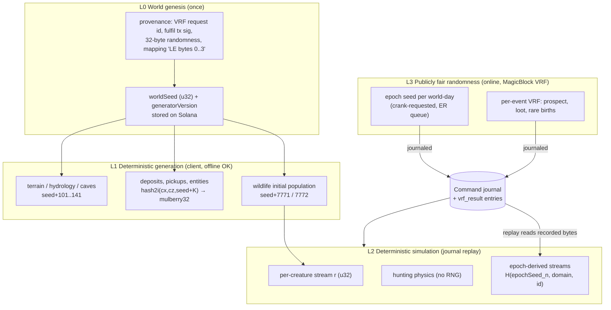
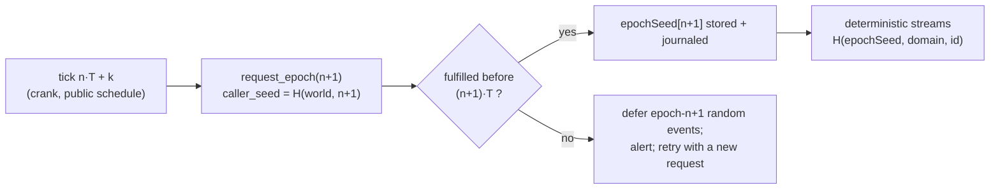

# MagicBlock Solana VRF and deterministic world generation for ASTrix

Research only. Nothing in `/projects/sandbox/Astrix` was modified. Nothing was deployed, no keys or accounts were created, no transactions were sent. The only network reads were public web pages, GitHub clones and three read-only `getAccountInfo` calls against public Solana mainnet RPC.

**Check date for every source below: 2026-11-26.**

## Evidence labels

| Label | Meaning |
|---|---|
| **[Doc]** | Officially documented (docs.magicblock.gg or the repo README) |
| **[Src]** | Verified in source code (file and line given). **[Src·chain]** = read from the live mainnet account with read-only RPC |
| **[Ex]** | Demonstrated in an example (MagicBlock examples, or ASTrix's own devnet run of 2026-11-24) |
| **[Bench]** | Independently benchmarked. **No benchmark was run for this report** (no devnet allowed), so this label is not used for any claim |
| **[Inf]** | Architectural inference (my reasoning from the above) |
| **[Unk]** | Unknown. The question for MagicBlock is listed in section 5 |

Quotations are avoided; everything is paraphrased.

## Sources (all checked 2026-11-26)

| Id | Source | Version pinned |
|---|---|---|
| S1 | VRF program, oracle, crypto: https://github.com/magicblock-labs/solana-vrf (the old name `ephemeral-vrf` serves the same repo). Local clone: `research/magicblock/src/ephemeral-vrf/` | HEAD `692f98912cf028a95b28fd7879c310cde559fdb2` (2026-11-03). Its diff from `4c6c97d` touches only CI and README, so program/api/vrf source equals `4c6c97d` |
| S2 | VRF SDK (inside `ephemeral-rollups-sdk`): https://github.com/magicblock-labs/ephemeral-rollups-sdk/tree/main/rust/vrf-sdk and `rust/vrf-macro`. Local: `research/magicblock/src/ephemeral-rollups-sdk/` | `4545ccf3db26dc43a5cac0e2f0fa70f8e53f3026` (2026-11-18) |
| S3 | Docs repo https://github.com/magicblock-labs/docs (local `research/magicblock/src/docs/`), rendered at https://docs.magicblock.gg. The live Security page was fetched and matches the repo | `832ccae9100dfcdbc7451d34bc3c727a0c7b03e4` (2026-11-19) |
| S4 | Local examples `/projects/sandbox/.tools/magicblock-examples-main/` (roll-dice, rewards-delegated-vrf, gachapon-example, binary-prediction) | local copy |
| S5 | Local skill `/projects/sandbox/.tools/magicblock-dev-skill-main/skill/` (VERSION 0.5.0) | local copy |
| S6 | RFC 9381 (ECVRF): https://www.rfc-editor.org/rfc/rfc9381.html | published RFC |
| S7 | Solana mainnet RPC `https://api.mainnet-beta.solana.com`, read-only `getAccountInfo` on the VRF program and its program-data account | slot ≈ 474,285,385 |
| S8 | ASTrix (read-only), repo `/projects/sandbox/Astrix` | HEAD `aad7660ff013244803794ab36fe8b8195d2d8a52` (2026-11-26) |

Short paths below: `vrf/…`, `api/…`, `program/…`, `vrf-oracle/…` are inside S1. GitHub URL form: `https://github.com/magicblock-labs/solana-vrf/blob/692f98912cf028a95b28fd7879c310cde559fdb2/<path>#L<a>-L<b>`.

---

# 1. How MagicBlock VRF works

## 1.1 What a VRF is

A verifiable random function is a keyed hash with a public check. The holder of a secret key can compute an output for any input, and anyone with the matching public key can confirm that the output is the correct one for that input. For a given key and input there is exactly one valid output. So the key holder cannot pick among several results. Without the secret key nobody can predict the output, not even someone who knows the input. ([S6] §1, §3.)

For a game this means: once the input is fixed, the result is fixed but unknown. When the result arrives, a proof shows it was not chosen after the fact.

## 1.2 The construction: an ECVRF-style proof on Ristretto255, but not an RFC 9381 ciphersuite

**What the code does** [Src] (`vrf/src/vrf.rs` L13-158, `api/src/verify.rs` L69-172, `vrf/src/consts.rs` L1-5):

| Step | Implementation |
|---|---|
| Oracle VRF key | `sk` comes from HKDF-SHA512 over the oracle's Solana keypair bytes. `pk = sk·G` on Ristretto255 (`vrf.rs` L13-21). The VRF key is derived deterministically from the oracle's Solana signing key. |
| Hash to group | Try-and-increment: SHA-256 of (domain tag, counter, input), decompressed as a Ristretto point, up to 512 tries (`vrf.rs` L26-35; on-chain `verify.rs` L145-155). |
| Output point | `Γ = sk·H(input)` (`vrf.rs` L56-58). |
| Nonce | Deterministic: HKDF-SHA512 over (sk ‖ input) with a domain salt (`vrf.rs` L62-74). |
| Proof | Chaum–Pedersen equality-of-discrete-log proof. The commitments are `U = k·G` and `V = k·H`. The challenge is `c = H_s(SHA-256(tag ‖ Γ ‖ U ‖ V ‖ pk ‖ input))` and the response is `s = k + c·sk`. The proof is sent as **(Γ, U, V, s)**, which is 128 bytes (`vrf.rs` L77-100). |
| Verification | Recompute `H` and `c`. Check `s·G == U + c·pk` and `s·H == V + c·Γ`. On chain this runs through Solana's `solana_curve25519` Ristretto add and multiply syscalls (`verify.rs` L101-135). |
| Randomness delivered | The callback gets **SHA-256(Γ)** as `[u8; 32]`, not Γ itself (`program/src/provide_randomness.rs` L172). |

**How it compares to RFC 9381** [Src + S6]: RFC 9381 defines four ECVRF ciphersuites, on P-256 and edwards25519 only. Their proof is (Γ, c, s) with a 16-byte c (80 bytes for edwards25519), and the output is a hash of cofactor·Γ with suite tags. MagicBlock instead uses:
- the Ristretto255 group;
- SHA-256 hashing, via Solana's `hash`;
- its own domain tags such as `VRF-Ephem-v2-HashToRistretto`;
- a proof that carries U and V instead of c;
- SHA-256(Γ) as the output.

The docs ([S3] `technical-details.mdx` L7) and README ([S1] `README.md` L20, L24) describe it as following RFC 9381 with Ristretto and a Schnorr-like proof [Doc]. The precise statement is that it is **modelled on ECVRF but is not one of RFC 9381's ciphersuites**, so RFC 9381 test vectors and third-party RFC 9381 verifiers do not apply [Inf]. Ristretto is a prime-order group, so the cofactor handling that RFC 9381 needs for edwards25519 does not arise [Inf]. MagicBlock lists two audits, by Zenith (2025-08-06) and ARDA (2026-09-06) [Doc] (`README.md` L20-24; PDFs under `security_audits/`). **I did not read the audit PDFs** because no PDF text tool was available in the sandbox.

## 1.3 Who runs the oracle and how keys are registered

- Oracles are a **permissioned set run through on-chain queues** [Doc] ([S3] `introduction/faq.mdx` L21-23).
- Adding or removing an oracle (its Solana identity plus its Ristretto VRF public key) requires the signer to be **the VRF program's upgrade authority** [Src] (`program/src/modify_oracles.rs` L57-69). The code comment says this authority should be a multisig. The oracle record holds `vrf_pubkey`, `registration_slot` and `open_queues` (`api/src/state/oracle.rs` L7-11).
- Each queue PDA is seeded by **one oracle's key** plus an index, `[b"queue", oracle, index]`. Only that oracle can fulfil requests in that queue [Src] (`provide_randomness.rs` L97-103).
- The upgrade CI opens **Squads** multisig proposals, and the repo variable describes the multisig vault as the upgrade authority [Src] (`.github/workflows/propose-program-upgrade.yml` L3-8, L45-49).
- On mainnet, program `Vrf1RNUjXmQGjmQrQLvJHs9SNkvDJEsRVFPkfSQUwGz` has program data `CrMJ8fvhdUDTUmvY9rV24gQ6gBdqAjx5P4YZbEkduhp1`, upgrade authority `Dsjad1Bs9aoE6nH6sg8kdNX22XMvnGiKcRJeeeTGW7zJ` and last deploy slot 457,592,029 [Src·chain]. The authority is a System-owned account with no data. That fits a Squads v4 vault PDA, but a plain wallet looks the same, so it is unproven [Inf]/[Unk].
- The program ID is `Vrf1RNUjXmQGjmQrQLvJHs9SNkvDJEsRVFPkfSQUwGz` (`api/src/lib.rs` L26). Default queues: base layer `Cuj97ggrhhidhbu39TijNVqE74xvKJ69gDervRUXAxGh`, Ephemeral Rollup `5hBR571xnXppuCPveTrctfTU7tJLSN94nq7kv7FRK5Tc`. Mainnet and devnet use the same addresses [Src] ([S2] `rust/vrf-sdk/src/consts.rs` L4-15) [Doc] ([S3] `introduction/technical-details.mdx` L25-37).
- The off-chain oracle daemon is open source (`vrf-oracle/`) [Src]. Who operates the production instances, and how many, is not documented [Unk].

## 1.4 Input (seed) composition

`RequestRandomness` stores a request whose **id, which is also the VRF input**, is SHA-256 over the following [Src] (`program/src/request_randomness.rs` L76-81, L128-147):

1. `caller_seed`: 32 bytes chosen by the calling program;
2. the current slot;
3. the most recent hash in the SlotHashes sysvar (bytes 16..48);
4. the callback discriminator;
5. the callback program id;
6. the Unix timestamp;
7. the request's byte offset in the queue. The program logs this as `Idx:` so the id can be rebuilt off chain.

The requester controls only `caller_seed`, and indirectly the timing. The slot hash and the queue position are fixed when the request lands.

## 1.5 Request flow (accounts, instruction, queue)

[Src] `request_randomness.rs` L8-38, L57-73; [S2] `rust/vrf-sdk/src/instructions.rs` L28-55; `rust/vrf-macro/src/lib.rs` L86-130.

- **Accounts:**
  - `payer`: signer, writable;
  - `program_identity`: the caller's PDA `[b"identity"]` under the *calling* program, which must sign;
  - `oracle_queue`: writable, owned by the VRF program;
  - System program;
  - SlotHashes sysvar.
- **Only your own program can request randomness that is delivered to your callback.** The identity PDA must be derived from `callback_program_id` and must sign, which only that program can do through `invoke_signed` (L67-69). `#[vrf]` injects these accounts and an `invoke_signed_vrf` helper.
- **Parameters:**
  - `caller_seed`;
  - the callback discriminator, at most 8 bytes (L95-97);
  - the callback account metas;
  - optional `callback_args` bytes, which are appended after the randomness in the callback data. Examples use this to forward a request nonce.
- **Priority and identity mode:** there are regular and high-priority requests. Scoped identity is the default, and the legacy global identity is deprecated (`vrf-macro` L120-130; [S5] `references/vrf.md` L39-60).
- **Queue limits:**
  - a paused queue rejects new requests (L89-92);
  - the queue account is capped at 512 KiB so that queue scans fit in 1.4 M CU (`api/src/consts.rs` L27-30).

```mermaid
sequenceDiagram
    autonumber
    participant P as Player / client
    participant G as ASTrix program (on ER or Solana)
    participant V as VRF program (Vrf1…)
    participant Q as Oracle queue PDA
    participant O as MagicBlock oracle (off-chain)
    P->>G: prospect(…) [pays cost, sets pending + nonce]
    G->>V: CPI RequestRandomness (signed by G's identity PDA)
    V->>Q: append item, id = SHA256(caller_seed, slot, slothash, disc, program, time, idx)
    V-->>Q: fee 0.0005/0.0008 SOL (base queue only; ER queue free)
    O->>Q: watches queue (subscription + snapshots)
    O->>O: Γ = sk·H(id), proof (U,V,s)
    Note over O,V: must land in a later slot than the request
    O->>V: ProvideRandomness(id, Γ, U, V, s) + callback accounts
    V->>V: check oracle is registered; queue PDA matches; verify proof
    V->>Q: remove item
    V->>G: CPI callback(disc, SHA256(Γ), callback_args), signed by scoped identity PDA
    G->>G: check signer == scoped identity; check nonce; apply outcome
```

## 1.6 Callbacks

All [Src] in `program/src/provide_randomness.rs` unless noted.

- **They are supported and run atomically with verification.** Proof check, queue removal and callback CPI happen in one instruction (L141-212). If the callback fails, the whole fulfilment fails and the request stays in the queue.
- **Signer:**
  - **Scoped mode (the default):** the VRF program signs as PDA `[b"identity", callback_program_id]` under the VRF program (L187-200).
  - **Legacy mode:** it signs as the global identity `9irBy75…` and applies an allow-list of executable accounts (L5-14, L203-212).
  - Callbacks must check the scoped PDA, using `#[vrf_callback]` or a compile-time constant [Doc] ([S3] `introduction/security.mdx` L7-20). Code that trusts the legacy identity should not be copied [S5] (`references/vrf.md` L53-60).
- **Account list:** it is fixed at request time from `callback_accounts_metas`. The oracle's own key may not appear in it (L120-128). The first account passed to the callback is always the identity signer (L163-168, instruction built at L176-180).
- **Compute:** the oracle sets the transaction CU limit to **300,000 (regular) or 400,000 (high priority)**, plus an attempt counter of 0-255 used as a nonce. That budget covers proof verification, queue work *and* your callback [Src] (`vrf-oracle/src/oracle/processor.rs` L554-564). ASTrix measured this limit in practice: a callback that ran `find_program_address` through `#[vrf_callback]` failed with `ProgramFailedToComplete` after about 268k CU. With a compile-time identity constant it uses a few thousand CU [Ex: ASTrix] (`Astrix/13_Integration_and_QA/Evidence/MB001-devnet-20261124/REPORT.md` L45-46; `Astrix/chain/programs/astrix-settlement/src/lib.rs` L56-60, L293-295). The SDK's `random_u8_with_range` helper was also avoided there for compute reasons (lib.rs L293-295).
- **Randomness helpers** [Src] ([S2] `rust/vrf-sdk/src/rnd.rs`):
  - `random_u8` returns byte 30 (L10-12);
  - `random_u32` uses bytes 28..31 (L58-60);
  - `random_u8_with_range` rejection-samples from the end of the array (L31-47).
  - A project should pin one byte-to-value mapping and keep it [Inf].

## 1.7 Latency

- **[Doc]** The pricing table gives under 50 ms for the ER queue, under 500 ms for high priority on Solana, and "1/2 seconds" for regular priority on Solana ([S3] `introduction/pricing.mdx` L21-31). Request and callback are separate transactions, and the callback lands in a later slot ([S3] `introduction/faq.mdx` L13-15).
- **[Src]** The program requires the fulfilment slot to be greater than the request slot (`provide_randomness.rs` L131-135). The oracle waits for that slot, can send early, and retries every slot. On Solana the floor is therefore at least one slot after the request lands [Inf].
- **[Ex: ASTrix]** Three prospects were fulfilled on devnet-eu (`REPORT.md` L24-25), but **latency was not timed**.
- **[Bench]** None. Latency has not been measured independently.

## 1.8 Cost

- **[Doc][Src]**
  - Base-layer queue: **500,000 lamports (0.0005 SOL)** regular, **800,000 lamports (0.0008 SOL)** high priority, per request (`api/src/consts.rs` L20-21; `pricing.mdx` L9-31).
  - The fee moves from payer to queue at request time and to the oracle at fulfilment (`request_randomness.rs` L150-165; `provide_randomness.rs` L215-222).
  - **The ER queue `DEFAULT_EPHEMERAL_QUEUE` is fee-exempt** (`program/src/fees.rs` L11-20).
  - Fees on purged (expired) requests go to the oracle. **There is no refund** (`program/src/purge_expired_requests.rs` L58-64; `pricing.mdx` L9).
- **[Ex: ASTrix]** ER transactions cost 0 on devnet (`REPORT.md` cost table).

## 1.9 Failure handling

- **Retries [Src]** (`vrf-oracle/src/oracle/processor.rs`):
  - up to 100 attempts per request (L317);
  - backoff of 1, 2, 4 … up to 32 slots on errors (L427-438);
  - the priority fee doubles roughly every 8 attempts, up to a cap (L567-569);
  - the oracle stops if the request is gone (L389-391);
  - if the callback fails with an Anchor address-constraint error, it waits until the request expires and then purges it (L395-400).
- **Timeout [Src][Doc]:** TTL is 120 s, measured from the request's own timestamp (`api/src/consts.rs` L23-25). After that, **anyone** may purge (`purge_expired_requests.rs` L11-13, L45). ProvideRandomness has **no age check**, so a request can still be fulfilled after its TTL until someone purges it ([S3] `introduction/security.mdx` L26; `how-to-guide/best-practices.mdx` L20-24). The local skill measured the purge window at 121-124 s, because timestamps are stored in 4-second units [Ex: S5] (`references/vrf.md` L198-222).
- **No callback:** your program is **never notified** of expiry. The application must provide its own pending → timeout → cancel/retry state, and must reject late or superseded callbacks [Doc] (best-practices L20-24) [S5] (`references/vrf.md` L224-242).

## 1.10 Manipulation and replay resistance

| Threat | Finding |
|---|---|
| Requester chooses the seed | `caller_seed` is free, but it is hashed with the slot, SlotHashes, timestamp and queue position. The output also needs the oracle's `sk`. A requester can choose the *input* but cannot evaluate the *output*, so grinding `caller_seed` gains nothing unless the requester colludes with the oracle [Src] (`request_randomness.rs` L136-144) [Inf]. MagicBlock still advises against letting players supply the whole seed [Doc] (best-practices L10-13). |
| Retry until favourable | The output is applied atomically inside the callback, so the requester never sees a result it could refuse. "Retry" only helps if the game refunds the cost or lets the player undo an applied result. Charge at request time and never let a result be cancelled after it is applied [Inf]. ASTrix already charges 4 food at request time (`chain/…/lib.rs` L267-270). |
| Front-running | Another program cannot request randomness delivered to your callback, because your identity PDA must sign (`request_randomness.rs` L67-69) [Src]. The docs say others cannot front-run [Doc] (security.mdx L22). The fulfilment transaction reveals Γ only when it executes, and the callback runs in that same transaction [Src]. |
| Spoofed callback | The scoped-identity signer can only be produced by the VRF program after a valid proof [Src] (L141-149, L187-200). This holds only if the callback actually checks that signer [Doc]. |
| Replay of an old proof | The proof is bound to the input (the request id). The request must exist in the queue (L115-117) and is removed when fulfilled (L152). The input includes slot, slothash and time, so a later request cannot share an id [Src]. |
| Oracle chooses the result | It cannot: Γ is unique for (pk, input), and the proof is checked against the *registered* `vrf_pubkey` [Src] (L81-89, L141-149). |
| Oracle withholds | It **can**. The oracle learns Γ as soon as it sees the request and can choose not to deliver. VRF gives uniqueness, not liveness or non-disclosure [Inf]. Mitigations: charge at request, offer no free re-roll after a timeout, and monitor the fulfilment rate. |
| Late or duplicate delivery | Possible after a cancel and re-request, because fulfilment has no age limit. Bind each callback to a stored nonce [Doc][Ex] (gachapon `pull_id` in `callback_args`, `gachapon-example/programs/gachapon-example/src/lib.rs` L102-119, L176-189, L217-240). |

## 1.11 Inside an Ephemeral Rollup

- **[Doc]** The same program and SDK work in an ER. You select the ER queue, and the proof is verified the same way (`README.md` L16; `introduction/solana-vrf.mdx` L9-11). The ER queue is already delegated, so integrators delegate nothing (`best-practices.mdx` L8; `faq.mdx` L23).
- **[Ex]** `rewards-delegated-vrf` pins the queue to `DEFAULT_EPHEMERAL_QUEUE` (`rewards-delegated-vrf/anchor/programs/rewards-delegated-vrf/src/lib.rs` L237). It requests with a high-priority scoped call (`instructions/request_random_reward.rs` L57-62) and schedules a post-commit transfer from the callback (`instructions/consume_random_reward.rs` L39-49, L98). `roll-dice-delegated` does the same with a delegated player account (`roll-dice/anchor/programs/roll-dice-delegated/src/lib.rs` L36-79). ASTrix ran it on devnet-eu (validator `MEUGG…`, core 2.0.4) [Ex: ASTrix] (`REPORT.md` L1-4, L24-25).
- **Does the result have to be committed to Solana first?** No. The callback writes ER state immediately, and other ER instructions can use it in the next transaction [Src][Ex]. It becomes *durable on Solana* only when the delegated account is committed. Solana does **not re-verify the VRF proof** on commit; it accepts the ER's committed state under MagicBlock's ER trust model [Inf]. The proof stays in the ER fulfilment transaction's instruction data and is not written to any account [Src] (callback data L172).
- Whether `DEFAULT_EPHEMERAL_QUEUE` is served on every public ER region (eu, us, asia) is [Unk].

## 1.12 Combining VRF with cranks (scheduled tasks)

- **[Doc: S5]** MagicBlock positions ER + cranks + VRF together for automated game economies (`references/composition-patterns.md` L15-18).
- **A constraint to note [Ex: S5]:** a crank-scheduled instruction may carry only the crank signer PDA as a *read-only* signer (`references/cranks.md` L109-122). `RequestRandomness` requires `payer` to sign (`request_randomness.rs` L63-64), and the SDK marks it writable (`instructions.rs` L39). The ER queue charges no fee, so the program only checks the signature. A program-owned PDA payer signed with `invoke_signed` would likely meet the requirement [Inf]. **No example shows a crank that requests VRF** [Unk].
- The ASTrix tick crank already runs every 2 s and is signed by MagicBlock's `8hwz…` [Ex: ASTrix] (`REPORT.md` L20-21; `chain/…/lib.rs` L243-259).

## 1.13 Trust model

| You must trust | Why | Checkable? |
|---|---|---|
| Oracle **liveness** (MagicBlock-run, permissioned) | Nothing else fulfils a queue. A request that is never fulfilled expires with no refund | Yes, by monitoring the fulfilment rate |
| Oracle **secrecy** of `sk` (no leaking, no collusion) | Whoever holds the oracle keypair can compute every output as soon as a request lands (key derived via HKDF, `vrf.rs` L13-21) | No |
| Oracle **not withholding selectively** | It can drop outcomes it dislikes. It cannot change them | Statistically only |
| **Correctness** | Guaranteed by the on-chain proof check against the registered key. You do not need to trust the oracle for this | Yes, from the proof (in the fulfilment transaction) |
| **VRF program upgrade authority** (Squads multisig per CI) | It can register oracle keys and upgrade the verifier itself | On chain: watch program upgrades and oracle-set changes |
| **ER validator** (for the ER queue) | It sequences fulfilments, produces the ER slot hashes that feed the input, and commits state to Solana without proof re-verification. The ER operator and the oracle operator are both MagicBlock | Partly |

**In short:** VRF removes trust in the *value* but not in *availability* or *confidentiality before reveal*. For ASTrix, that is adequate for discoveries and loot, provided the cost is charged at request and there is no free re-roll [Inf].

---

# 2. Applying it to ASTrix

## 2.1 What ASTrix does today

- **Seed:** world generation is a pure function of a numeric `seed` (u32 semantics) and a generator version (`Game/src/sim/world.ts` L9, L236-262). Layers are separated by additive offsets, `seed + 101 … seed + 141` (L308-453). Primitives: `hash2i`, `hash3i` and `mulberry32` (`Game/src/sim/noise.ts` L12-33).
- **Per-domain streams:** each domain has its own per-chunk stream, created with `mulberry32(hash2i(cx, cz, seed + K))`:
  - entities: K = 900 (`world.ts` L1084);
  - pickups: K = 7717 (`gathering.ts` L5-9, L259);
  - deposits: K = 7919, with fields at 7811-7831 (`deposits.ts` L13-16, L99-122);
  - prey: K = 7771 and predators: K = 7772 (`wildlife.ts` L315, L353; `fauna.ts` L156, L217).
  - Each stream draws a fixed number of values per lattice cell, so results do not depend on load order (`gathering.ts` L250-253).
- **Per-creature streams:** each creature carries its own 32-bit stream, `rng` / `r`, seeded from the chunk stream and advanced with a mulberry32 step (`fauna.ts` L117-123, L183; `wildlife.ts` L33-36, L394-395). Movement is integer-only so that replays match.
- **Hunting:** an arrow is a journaled `shoot` command flown by deterministic physics. There is **no RNG**, and the outcome depends on skill (`hunting.ts` L1-30).
- **Journal:** entries are `{command, sequence, revision, hash, outcome}`, and the journal carries `seed` (`Game/src/app/session.ts` L191-201).
- **Not built yet:** breeding, genetics and weather do not exist in these files. Breeding and trade are planned (`00_Project_Core/Wilderness_Architecture_2026-11-25.md` L52; `World_Engine_Architecture_2026-11-23.md` L83).
- **Chain:**
  - `initialize(world_seed: u32, generator, …)` stores a seed **supplied by the caller** (`chain/programs/astrix-settlement/src/lib.rs` L95-100).
  - `prospect` charges 4 food, sets `prospect_pending` and requests VRF with `caller_seed = [client_seed; 32]` (L263-286). The CLI picks `client_seed` with `Math.random` (`chain/client/scripts/astrix.ts` L243-246).
  - `prospect_callback` checks the scoped identity constant and maps the randomness to 1..100: 1-55 nothing, 56-90 ore vein, 91-100 crystal (L289-311, L986-991).
  - `cancel_prospect` lets the owner clear a pending prospect without a refund (L315-318).
  - On devnet, three prospects were fulfilled with rolls 10, 62 and 44 [Ex: ASTrix] (`REPORT.md` L24-25; `00_Project_Core/MagicBlock_Architecture_2026-11-24_status.md` L11).

**Problems found in the current VRF integration [Src][Inf]:**

1. **The callback is not bound to a request.** After `cancel_prospect` and a new `prospect`, a late fulfilment of the old request settles the new one. The new request's callback then fails with `NoProspect`, retries until TTL and is purged, and its fee or food is lost. No outcome is biased, but the accounting is wrong. Fix: put a `prospect_nonce` in `callback_args` and require it to equal the stored pending nonce. This is the gachapon `pull_id` pattern.
2. **`cancel_prospect` can be called at any time.** Allow it only after the deadline, for example `now ≥ requested_at + 130 s`. That matches the 121-124 s purge window plus margin.
3. **The `caller_seed` is random but not recorded.** It does not affect fairness. Making it reproducible, for example SHA-256(settlement, nonce), lets auditors rebuild the request id.
4. **The world seed is caller-chosen.** A world creator can try many u32 seeds and keep the one with the best deposits. See 3.2.
5. **Seed-derived deposits are public knowledge** [Inf]. The generator is deterministic and the seed is on chain, so anyone can compute every deposit location and quantity (`deposits.ts` L120) offline. A "rare discovery" cannot be secret if it derives from the seed.

## 2.2 Decision per system

| System | Choice | Why |
|---|---|---|
| Terrain, hydrology, caves, ore *outcrops*, trees | **Deterministic seed only** | Every client and offline replay needs it each frame. It renders, it never needs consensus, and the architecture says so (`MagicBlock_Architecture_2026-11-23.md` L41, L57). A VRF call per chunk would be slow, cost money on the base layer and break offline play. **Never use VRF here.** |
| Resource *distribution* (deposit placement, type field, base quantity) | **Seed** for placement and type; **hybrid** for hidden value | Placement must be visible and stable for pathing, mining and rendering. Value that should be a surprise (a vein's richness, a crystal pocket) should be revealed by a **per-event VRF when prospected**, because the public seed makes anything seed-derived predictable. |
| Wildlife *initial* spawning per chunk | **Seed** | Already pure in (seed, generator, chunk) with stable ids and tombstones (`wildlife.ts` L7-17). It is needed to materialise creatures offline and in replay. |
| Per-tick animal decisions, movement, predator chases | **Seed: each creature's own stream** | High frequency, must replay bit-exact, has no economic value per draw. **Never VRF**: 0.5 Hz × N creatures would mean thousands of requests, plus latency and a dependency on being online. |
| Wildlife respawn, migration waves, population events | **Hybrid: VRF epoch seed** | Shared worlds need one public result per epoch that nobody chose. Within an epoch, derive deterministically, e.g. `H(epochSeed, "spawn", cx, cz, i)`. |
| Weather events | **Hybrid: VRF epoch seed per world-day**, requested one epoch ahead | Weather affects crops and the economy and must be identical for all clients. The intra-day sequence is `H(epochSeed, "weather", day, region)`. Offline-only worlds with no economic stake can use `H(worldSeed, day)`. |
| Animal genetic variation (wild, first generation) | **Seed** (genes = `H(worldSeed, "genes", creatureId)`) | Creatures are derived per chunk with stable ids. Genes must stay the same when a creature is materialised again. |
| Reproduction outcomes (offspring genes, litter size) | **Hybrid, commit-before-reveal**; **per-birth VRF** for settled or tradeable animals | The breeding command journals the parents and the epoch first. The outcome uses `H(seed of epoch N+1, parents, birthSeq)`. If the outcome used an *already public* epoch seed, players could compute it and pick pairs ([Inf], see rule R3). Use a per-birth VRF when the offspring is an on-chain asset. |
| Rare discoveries (prospecting, rare timber, artefacts) | **Per-event VRF** (already done for prospecting) | Valuable, contested and player-initiated. The cost is charged at request and the outcome is applied atomically in the callback. |
| Loot and rewards (expedition loot, quest drops, raffles) | **Per-event VRF**, using the `rewards-delegated-vrf` pattern | Value goes to Solana, so it must be publicly fair. Use the ER queue (free) and commit or settle through post-commit actions. |
| Hunt and fishing *hits* | **Deterministic physics** (as now) | Skill-based and replayable. Adding VRF would hand skill outcomes to chance. If a *yield* roll (pelt quality) becomes valuable, use per-event VRF **after** the hit is journaled. |
| Anything that must work offline or replay without a record | **Never VRF at replay time** | VRF output exists only after an online callback. Replay must read the recorded output and never re-request. |

### Design rules

- **R1:** Use VRF only for outcomes that are valuable, shared or contested *and* happen rarely: one per player action or one per epoch.
- **R2:** A VRF output becomes a **journaled input**. Replay never recomputes or re-requests it.
- **R3 (commit before reveal):** A player action must be fixed (journaled and paid) *before* the randomness that decides it is known. A public epoch seed may decide only outcomes that players cannot steer, or outcomes committed before that seed was revealed.
- **R4:** Do not use VRF in per-tick or per-frame paths, in generation, or in anything needed offline.

---

# 3. A coherent randomness architecture for ASTrix

## 3.1 Layers



Domain separation: keep separate streams per domain, as ASTrix already does. New domains derive with `SHA-256(tag ‖ seed ‖ ids)` or `hash2i` with an unused offset. Note that additive offsets (`seed + 101`, `seed + 102` …) make world `s+1`'s layer 101 equal world `s`'s layer 102 [Src: `world.ts` L312-313] [Inf]. Neighbouring seeds therefore share shifted layers. This is harmless for VRF-derived seeds, which are effectively never adjacent. It should not be extended to new domains, which should use tagged hashing.

## 3.2 A reproducible world seed that is also verifiable at creation

Today the creator passes `world_seed` (`lib.rs` L95). Options:

| Option | How | Fairness | Cost |
|---|---|---|---|
| **A. VRF genesis (recommended for ranked or shared worlds)** | `create_world` stores `status = AwaitingSeed` and requests VRF with `caller_seed = SHA-256("astrix-world", owner, slotIndex, generatorVersion)` and `callback_args = worldNonce`. The callback sets `world_seed = u32_le(randomness[0..4])`, stores the 32 bytes and sets `status = Ready`. No play is possible before `Ready`. | The creator cannot grind; MagicBlock cannot choose the seed. A creator can still abandon a world and create another, so limit this with a creation fee, a cooldown (the registry already has `claim_cooldown_s`, `lib.rs` L323) and a public record of every seed drawn. | ER queue: free. Base queue: 0.0005 SOL |
| B. Commit-reveal between owner and registry | Owner commits `H(s1)` and the registry/admin commits `H(s2)`. Both reveal, and the seed is `H(s1 ‖ s2)`. | Whoever reveals last can refuse to reveal (abort bias), so it needs a deposit forfeit and a deadline. | Two transactions, no oracle |
| C. Slot hash at creation | seed = `H(owner, slothash)` | A Solana leader, or the single ER validator, can bias it | Cheapest, weakest |
| D. Custom seed | The creator picks the seed | None. Flag the world "unranked" | — |

To verify a world's seed later: fetch the fulfilment transaction, read (input, Γ, U, V, s) from its instruction data and check the proof with the open-source `verify_vrf` (`vrf/src/vrf.rs` L104-158, Rust; it should compile to WASM but this was not tested [Inf]). Then check that `SHA-256(Γ)` matches the stored 32 bytes and that the u32 matches `world_seed`. To check that the input is the request id, rebuild it from the request transaction's slot, the SlotHashes entry, the timestamp and the logged `Idx:`.

## 3.3 VRF results as journaled input (replay stays deterministic)

```mermaid
sequenceDiagram
    participant U as Player
    participant S as Local sim / journal
    participant C as ASTrix program (ER)
    participant V as VRF
    U->>S: command prospect{nonce:n}
    S->>C: prospect(nonce n)  [food charged, pending=n]
    S->>S: journal: prospect_requested{n, reqSig}  (outcome: pending)
    C->>V: RequestRandomness(caller_seed=H(settlement,n), args=n)
    V-->>C: callback(randomness R, n)  [proof verified]
    C->>C: require pending==n; apply roll(R); pending=none
    S->>C: observe account / fulfil tx
    S->>S: journal: vrf_result{domain:"prospect", n, R, fulfilSig, Γ,U,V,s, input}
    Note over S: Replay: apply vrf_result.R exactly; never call VRF again
```

Proposed journal entry, shaped like the existing `{command, sequence, revision, hash, outcome}` [Inf]:

```ts
interface VrfResultCommand {
  type: 'vrf_result';
  domain: 'world_seed' | 'epoch' | 'prospect' | 'loot' | 'birth';
  nonce: number;            // the program-side request nonce (callback_args)
  randomness: string;       // hex, 32 bytes = SHA-256(Γ) as given to the callback
  mapping: 'u64le%100+1' | 'u32le0' | string; // pinned byte→value rule
  queue: string; requestSig: string; fulfilSig: string;
  proof?: { input: string; gamma: string; u: string; v: string; s: string; oracleVrfPk: string };
}
```

- Replay applies `randomness` through the pinned mapping. The proof fields are optional and let an auditor re-verify offline.
- While a request is pending, the local sim shows "randomness pending" and keeps moving deterministically. The pending outcome is resolved only by the `vrf_result` entry, never by a local fallback that would change the outcome.
- **Offline:** VRF-gated actions queue, or are disabled. Everything in L1/L2 works offline.

## 3.4 Epoch seeds without letting the server choose the timing

The goal is that no party, including the ASTrix server, can pick *when* randomness is drawn so as to aim it at known circumstances.

1. **Fixed public schedule.** Epoch *n* covers ticks `[n·T, (n+1)·T)`. The **crank** (on-chain schedule, publicly visible, MagicBlock-signed) calls `request_epoch(n+1)` at tick `n·T + k`, which is one full epoch ahead. Neither the server nor a player decides when the request happens.
2. **The callback is bound to the epoch.** `callback_args = n+1`. The callback writes `epochSeed[n+1]` only if that slot is empty and `n+1` is the expected next epoch.
3. **Outcomes are fixed before the seed exists (R3).** Anything an epoch decides, such as weather, spawn waves and births bred during epoch *n*, is either outside player control or committed in the journal before `epochSeed[n+1]` is revealed.
4. **A missing seed means deferral, not a fallback value.** If `epochSeed[n+1]` has not arrived by tick `(n+1)·T`, the epoch's random events wait: weather holds its last state and no spawn wave runs. A predictable fallback such as `H(prev, n)` would let whoever can cause a delay (the oracle, or the ER validator through censorship) choose between two known outcomes. Deferral removes that choice [Inf].
5. **The server never holds secret entropy.** All randomness is either public seed (L1/L2) or MagicBlock VRF (L3). The server only relays.
6. **Monitoring.** Alert on any missing or late epoch fulfilment. This is the only way to see oracle withholding.



On a crank-driven VRF request, the `payer` must sign. The workable route is a program-PDA payer with `invoke_signed` on the fee-free ER queue [Inf]. This is unverified and question Q3 asks MagicBlock about it.

## 3.5 Commit-reveal and other alternatives

| Method | When to use | Weakness |
|---|---|---|
| MagicBlock VRF (per event or epoch) | Valuable or shared outcomes | Oracle liveness, non-collusion, and MagicBlock running both the oracle and the ER |
| Player–server commit-reveal (both commit hashes, both reveal, outcome = H(a‖b)) | Two-party contests without an oracle | Whoever reveals last can abort; needs a forfeit and a deadline |
| Future slot hash (commit at slot t, use the hash of slot t+k) | Low-value cosmetics | The leader can bias it by skipping a slot. On an ER, one validator produces the hashes |
| Server-run VRF with its own key | A verifiable server | The server knows outputs early and controls timing, so it is fine for private worlds but not public fairness |
| Public beacon (e.g. drand) | A second, independent source to mix in | Not evaluated here [Unk]; adds an external dependency |
| Deterministic seed | Generation and simulation | Fully predictable to anyone with the seed |

A combination worth considering for high-value epochs: `epochSeed = H(VRF_R ‖ playerCommitsRoot)` [Inf]. MagicBlock alone could not then predict the result before the players' commits close. The cost is a reveal phase.

## 3.6 Immediate changes for the ASTrix prospect (if and when the code is changed; not done here)

1. Add `prospect_nonce: u32` and `prospect_requested_at: i64`. Pass the nonce in `callback_args` and require a match in the callback.
2. Allow `cancel_prospect` only after `requested_at + 130 s`.
3. Set `caller_seed = SHA-256("astrix-prospect" ‖ settlement ‖ nonce)`.
4. Journal `vrf_result` when the browser learns of the fulfilment (3.3).
5. Pin the byte mapping (the current one is `u64_le(R[0..8]) % 100 + 1`, `lib.rs` L295-296) as a versioned rule.
6. Before ranked or shared worlds: VRF genesis for `world_seed` (3.2).

---

# 4. Key findings, ranked by strength of evidence

1. **The proof is verified on chain before the callback, and the oracle cannot choose the value.** [Src] `provide_randomness.rs` L141-149 and `api/src/verify.rs` L69-136 check a DLEQ proof against the admin-registered `vrf_pubkey` (L81-89). Γ is unique per input.
2. **The construction is an ECVRF-style DLEQ proof on Ristretto255 with SHA-256, not an RFC 9381 ciphersuite.** [Src] `vrf/src/vrf.rs` L13-158 and [S6]. The proof is (Γ, U, V, s), 128 bytes, and the callback receives SHA-256(Γ).
3. **Request id = SHA-256(caller_seed, slot, slothash, discriminator, program, time, queue index).** The requester chooses only `caller_seed`. [Src] `request_randomness.rs` L136-144.
4. **There is no expiry notice and no refund.** TTL is 120 s and anyone may purge. Fulfilment is possible until the purge because there is no age check. [Src] `api/src/consts.rs` L25, `purge_expired_requests.rs` L45-64; [Doc] `security.mdx` L26.
5. **The callback budget is shared.** The oracle sets 300k or 400k CU for verification plus callback. [Src] `processor.rs` L554-564. ASTrix hit the limit at about 268k CU. [Ex: ASTrix] `REPORT.md` L45.
6. **The ER queue is free, base queue requests cost 0.0005 or 0.0008 SOL.** [Src] `fees.rs` L11-20, `consts.rs` L20-21; [Doc] `pricing.mdx`.
7. **Trust:** liveness and confidentiality before reveal depend on the MagicBlock oracle. Governance runs through the program upgrade authority, a Squads multisig according to CI. [Src] `modify_oracles.rs` L57-69, workflow L3-8; [Src·chain] authority `Dsjad1…`.
8. **ASTrix's prospect callback is not request-bound.** A late callback after a cancel and re-request can settle the wrong request. [Src] `chain/…/lib.rs` L263-318.
9. **ASTrix's world seed is caller-chosen and seed-derived deposits are public,** so the seed cannot make discoveries fair or secret. [Src] `lib.rs` L95-100, `deposits.ts` L120-122; [Inf].
10. **Latency figures are documented only.** There is no independent measurement, and ASTrix did not time its devnet fulfilments. [Doc] `pricing.mdx` L21-31.

---

# 5. Unknowns and questions for MagicBlock

| # | Question |
|---|---|
| Q1 | Who operates the production oracle(s) for `DEFAULT_QUEUE` and `DEFAULT_EPHEMERAL_QUEUE`, and how many are registered? Is there a public status page or fulfilment SLA? |
| Q2 | Is `Dsjad1Bs9aoE6nH6sg8kdNX22XMvnGiKcRJeeeTGW7zJ` the Squads vault? What is the threshold, and is there a timelock on upgrades and oracle-set changes? |
| Q3 | Can a **crank-scheduled** instruction request VRF, given that only the read-only crank signer may sign? Is a program-PDA payer on the ER queue the supported pattern? Is there an example? |
| Q4 | Is `DEFAULT_EPHEMERAL_QUEUE` served on every public ER region (devnet-eu/us/asia, mainnet regions), and on validator 2.x (ASTrix saw core 2.0.4 on devnet-eu)? |
| Q5 | What are measured p50 and p99 latencies for the ER queue and the base queues, and the historical fulfilment rate? |
| Q6 | How do you mitigate oracle withholding and leakage of outputs before fulfilment? Is the VRF secret in an HSM or TEE? It is HKDF-derived from the oracle's Solana keypair (`vrf.rs` L13-21). |
| Q7 | The README says the scheme follows RFC 9381, but the suite differs: Ristretto255, SHA-256, proof (Γ, U, V, s). Is there a written spec and test vectors for independent (e.g. WASM) verifiers? Do the audits cover the cryptography or only the program? |
| Q8 | When ER state that includes a VRF result is committed to Solana, is there any base-layer evidence of the proof, or is it trusted as ER state? |
| Q9 | What are the limits on callback account count and `callback_args` size per request, beyond the 512 KiB queue cap and the 8-byte discriminator? |
| Q10 | Will ProvideRandomness add an age check, so that expired requests cannot be fulfilled before they are purged? |

Items I could not establish myself: the audit contents (the PDFs were not read), latency (no benchmark), and whether the WASM build of `verify_vrf` works (not tried).
