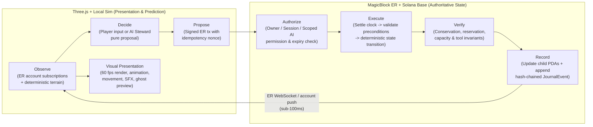
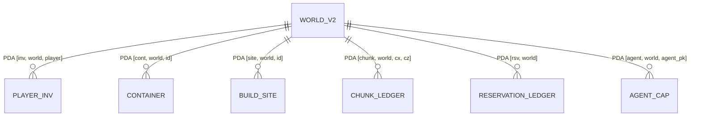

# Phase 3: Authoritative Architecture Proposal

**Date:** 2026-11-27  
**Status:** **[PROPOSAL]** — Design document only; awaiting owner review and approval before any code or devnet change.

---

## 1. Design Principles

1. **Authoritative economy, fluid Three.js presentation:** Three.js renders, animates, and runs client-side movement/collision/camera at 60 fps. MagicBlock ER (`devnet-eu.magicblock.app`) + Solana devnet is the **single source of truth** for ownership, resource existence, inventory/container balances, reservations, crafting outputs, construction state, world time, and persistent history.
2. **Zero trust in client outcome claims:** The client (human or AI steward) **never** submits `"add 6 logs"` or `"building complete"`. It submits **intent + verifiable preconditions** (`chop_tree(node_id, chunk, swings)` or `reserve_site(site_id, blueprint, sources)`), and the on-chain program computes and commits the resulting state transition.
3. **Reuse V2 without migrating existing worlds again:** All 32 numbered worlds are already `876`-byte V2 accounts (`AXv2`) with `128` reserved bytes (`WorldExt.reserved`, `v2.rs:134`). Phase 3 stores new wilderness/economy state in **dedicated child PDAs** seeded by `world` (and `player` / `container` / `chunk`), keeping the 876-byte `Settlement` V2 layout intact and backward-compatible with V1 (`4PV6…`) and V2 worlds.

---

## 2. Authority Boundary

### Strict Split of Responsibilities

| Layer | Owns (Authoritative) | Does NOT Own |
|---|---|---|
| **Three.js + Local Presentation (`Game/src/render`, `explore.ts`)** | Camera, 60 fps interpolation, avatar locomotion, animation, sound, LOD, foliage sway, placement ghost preview, local pathfinding & route display, local wildlife animation | Inventory quantities, item creation, tool durability, reservations, building completion, world time, ownership |
| **MagicBlock ER Program (`astrix-settlement` + child PDAs)** | World clock (`settle`), world ownership & ACLs, node depletion tombstones (trees/pickups/deposits), player & container inventories, reservations, tool durability, crafting recipes, construction stages & consumption, VRF outcomes, hash-chained journal | Frame-by-frame avatar `(x,y,z)`, camera angles, physics raycasts, chunk mesh geometry, per-frame animal steering |
| **Solana Devnet Base Layer** | Program binary & upgrade authority, delegation records, periodic durable checkpoints (`Passport` + committed world/PDA state), emergency escape hatch (`request_undelegation` / `rollback_undelegation`) | High-frequency gameplay ticks or per-swing mutations |

---

## 3. Action Classification Matrix (Immediate vs. Batched vs. Local)

| Category | Actions | Execution Tier | Rationale |
|---|---|---|---|
| **Immediate Authoritative (ER tx, ~10–50 ms)** | `claim_world_vrf`, `pickup_ground`, `drop_item`, `transfer_container`, `craft_item`, `place_site`, `deliver_site`, `cancel_site`, `claim_shelter`, `smelt_start`, `smelt_collect`, `prospect`, `transfer_ownership`, `grant_agent_cap` | **1 ER tx per action** (fee `0` on ER) | Changes inventory, ownership, or reservations; must be immediately conflict-checked to prevent double-spend. |
| **Batched / Milestone Authoritative (ER tx)** | Multi-swing work (`chop_tree`, `cut_trunk`, `work_site`, `mine_deposit`): client paces 650 ms visual swings locally and submits **1 ER tx per completed swing-burst (e.g., 1–4 swings per 2 s tick, capped by `SWINGS_PER_TICK=4`)** or at stage/felling completion with elapsed-tick rate check | **Batched (≤ 1 ER tx / 2 s tick)** | Enforces real work rate (`<= 4 swings / tick`) and tool durability on-chain without flooding 10 tx/s; prevents instant felling/building exploits. |
| **Periodic / Lazy Authoritative (ER clock)** | World clock (`settle`), crop growth, smelter completion, fuel burn, stump regrowth timers | **Lazy on-action + 30 s crank (`744xxx`)** | Already live in Phase 2 (`settle_core`). Zero extra tx overhead. |
| **Local-Only Presentation (Never On-Chain)** | Walking/sprinting, jumping, swimming, camera orbit, opening UI panels, map panning, waypoint preview, animal idle/graze visual steering, arrow flight animation | **Local only** | Pure presentation or client-side navigation; coarse position `(x, z)` is only passed as an audited precondition argument when interacting with a spatial node (reach-checked against node coordinates). |

---

## 4. Account Architecture (Zero Reallocation of V2 `Settlement`)

**[PROPOSAL]:** Keep `Settlement` at `876` bytes (`AXv2`) and use `WorldExt.reserved[0..32]` for a `p3_header` (`economy_version: u16`, `next_entity_id: u64`, `active_sites: u16`, `active_containers: u16`, `active_players: u16`). All Phase 3 state lives in **delegated child PDAs** created lazily on demand:

| Child PDA | Seeds | Est. Size | Purpose |
|---|---|---:|---|
| `PlayerInventory` | `["inv", world, player]` | ~512 B | Per-player bag (25 item slots × `u16`, weight cap 60), up to 8 tools with durability, equipped index, last `action_nonce: u64` (idempotency), last known coarse `(x_dm, z_dm)` + `last_action_tick` (rate/speed sanity). |
| `Container` | `["cont", world, id_u32]` | ~384 B | Ground piles (`kind=Pile`), stockpiles (`kind=Stockpile`), or storage buildings (`kind=Storage`, cap 300), with `(x_dm, z_dm)`, owner/ACL mode, item counts, and total reserved counts per item. |
| `BuildSite` | `["site", world, id_u32]` | ~512 B | Building kind, `(x_dm, z_dm, rot)`, stage, swings done, placed tick, `reserved` map (by source ID), `delivered`, `consumed`, fuel/smelt state. |
| `ChunkLedger` | `["chunk", world, cx_i16, cz_i16]` | ~1,024 B | Compact bitsets / bounded records of depleted pickups (`p:`), felled/damaged trees, fallen trunks, and remaining deposit quantities for that 64×64 m chunk (replaces trusting client claims about world nodes!). |
| `AgentCapability` | `["agent", world, agent_pk]` | ~160 B | Scoped AI steward session key: allowed instruction bitmask, max spend/tick, expiry timestamp, revocable by world owner in 1 tx. |

---

## 5. Deterministic Node Verification (Closing the "Invented Logs" Hole)

How does the on-chain program know a tree or pickup actually exists at `(cx, cz, idx)` without storing 50,000 trees on-chain?

**[PROPOSAL] Two-Tier Verification:**
1. **Option A (Preferred — On-Chain Deterministic Derivation for Node Class + Yield):** Port the lightweight integer chunk hash (`hash2i` + `mulberry32` from `Game/src/sim/noise.ts`, ~40 lines of Rust) or a **Merkle chunk-node manifest root** committed at genesis/chunk-first-touch. Given `(world.world_seed, cx, cz, node_idx)`, the program verifies the node's existence, species/stage (hence exact HP and timber yield `TIMBER[species][stage]`), and coordinates `(x, z)` deterministically on-chain, then flips its depletion bit in `ChunkLedger` so it can **never be harvested twice**.
2. **Option B (Fallback if terrain height is needed):** If full terrain height (`baseHeightAt`) is too expensive in CU for SBF, commit a per-chunk deterministic node-list hash (`chunk_nodes_root: [u8; 32]`) verified against a compact Merkle proof (depth 6–8, ~256 bytes) supplied by the client; the program verifies the proof against the deterministic chunk root and records depletion in `ChunkLedger`.
   - **CU comparison [ESTIMATE]:** Pure integer `mulberry32` check ~3–8k CU; Merkle proof verification ~12–18k CU. We will benchmark Option A in LiteSVM during Phase 3.1 before locking the choice.

---

## 6. Reconciling Client Prediction with Authoritative State

- **Optimistic UI vs. Confirmed Economy:**
  - Movement, camera, and swing animations remain instant (0 ms local latency).
  - Economy state transitions (bag counts, pile creation, reservations, building placement) wait for ER confirmation (**~50–150 ms** on `devnet-eu.magicblock.app`), showing a subtle pending indicator while in-flight.
  - On ER rejection (e.g., `InsufficientFreeStock`, `NodeAlreadyDepleted`, `BagFull`, `RateLimited`), the client displays the exact program error reason as a toast and never mutates local inventory.
  - Every committed ER state change updates the client's local mirror via ER WebSocket `onAccountChange` subscription, keeping `Game/src/sim` and the Three.js renderer in lockstep with on-chain truth.

---

## 7. Key Risks & Open Design Decisions

1. **Chunk PDA rent & delegation lifecycle:** Creating a `ChunkLedger` PDA on base devnet requires rent (~0.006 SOL) and delegation to ER. On devnet, an operator-funded world-rent vault (or lazy creation on base + delegate before first harvest in a chunk) is needed; players using Quick Play have 0 SOL. **Recommendation:** Pre-create and delegate the spawn chunk's `ChunkLedger` + `PlayerInventory` at world setup, and fund lazy chunk-PDA creation from a rate-limited world-creation/operator pool.
2. **Existing local saves (`localStorage`):** Per `HANDOVER.md` §2, **never reset or overwrite the owner's local farm or existing local wilderness saves**. Local-only worlds remain playable offline; MagicBlock-linked worlds use the authoritative ER mode (`?chain=1` / linked world slot) cleanly separated by save schema.
3. **Checkpoint scope (`Passport`):** As child PDAs are added, `checkpoint()` should commit `world` + `passport` + active `PlayerInventory` / `Container` PDAs (or batch commit via `MagicIntentBundleBuilder`), and the treasury burn rate will scale linearly with committed account count.
