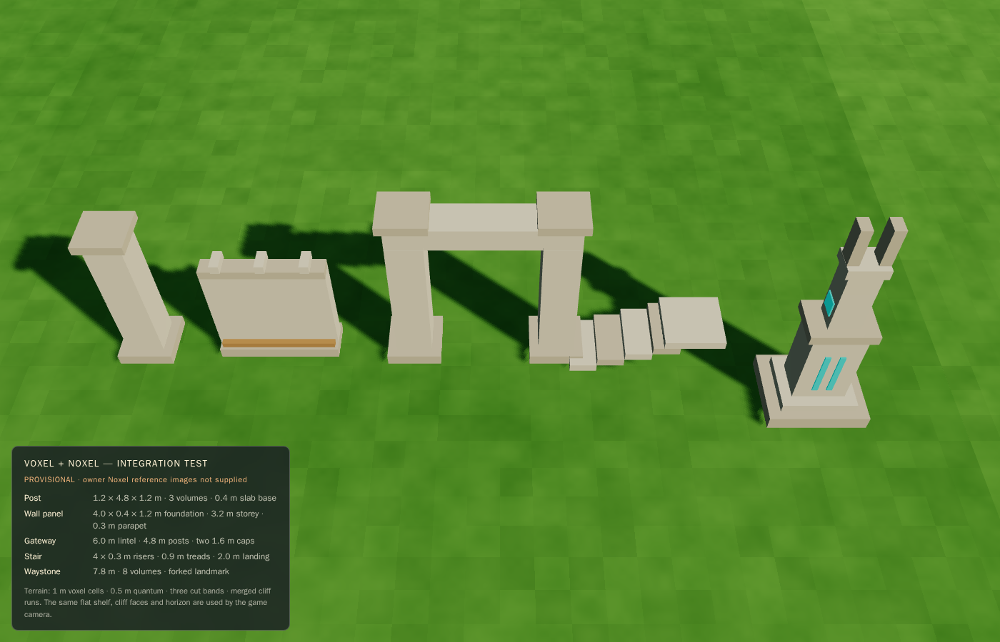
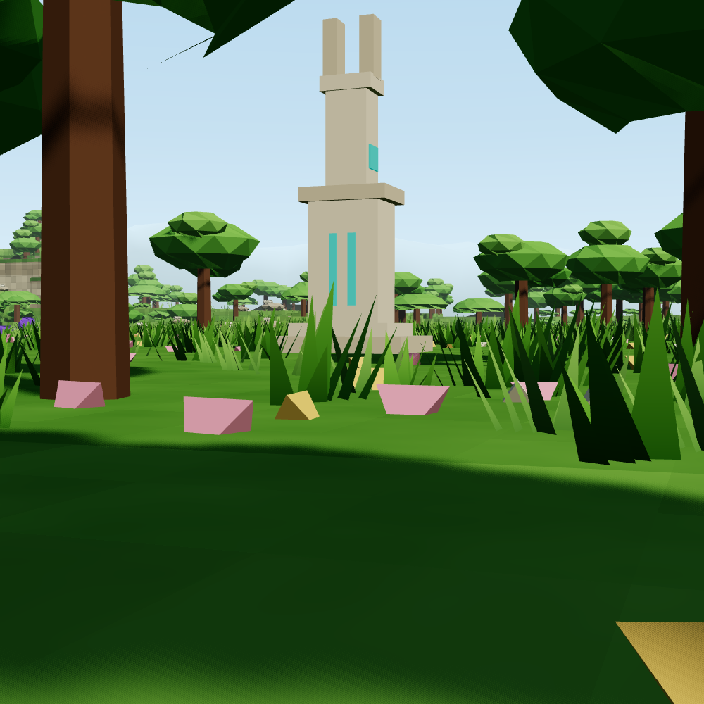

# AS-002 — Provisional Noxel reference sheet

**Status:** **PROVISIONAL — NOT APPROVED.**
**Date:** 2026-10-24 · **Owner:** Mimo (Lead Noxel Artist) · **Implementation:** DeepSeek
**Scope:** T-009 founder-tier kit and two in-world landmarks.
**Trace:** Noxel Style Guide v1.0 (`05_Noxel_Studio/Noxel_Style_Guide/Noxel_Style_Guide_v1.0.md`),
Decision Log D-003, D-012; palette v2.

> **Provenance warning.** The owner's Noxel reference images are still **not on disk** in
> `05_Noxel_Studio/Reference_Images/`. This sheet was built from the *written* grammar in the style
> guide and palette v2, not from the owner's images. It is a spec-conformant **candidate** for the
> integration test. It is not a final architecture reference and must not be used to approve
> Task 004 / Task 030.

---

## 1. What this sheet covers

| Asset | Type | In T-009? | Notes |
|---|---|---|---|
| Post | kit component | yes | simplest vertical marker |
| Wall panel | kit component | yes | 4 m panel with foundation, storey, parapet, caps |
| Gateway | kit component | yes | two posts, lintel, caps |
| Stair | kit component | yes | four 0.3 m risers, 0.9 m treads, 2.0 m landing |
| Waystone | landmark | yes, 1 site | forked crown, teal inlays, 7.85 m |
| Marker | landmark | yes, 1 site | smaller in-world threshold marker, 4.0 m |
| Bench | prop | no | modelled but not staged in the kit |

Out of scope: settlements, roofs, doors/windows, interiors, ruins, vegetation. Those remain later
tasks and are still gated behind the world review.

---

## 2. Visual sheet

*`T-009_noxel_kit.png`, 1400×900, `scene=kit`, 3/4 view. Left to right: post, wall panel, gateway,
stair, waystone. The waystone at the right edge appears to lean because of perspective; its volumes
are axis-aligned. The camera is deliberately close to a plan view so all five pieces and their
ground contact fit in one frame.*

*`T-009_noxel_closeup.png`, 1000×1000. The forked waystone at the founder-valley site, with the
terrain, grass and trees at the same scale. This is the coexistence frame; it is not a beauty render
for a hero image.*

The kit image is the visual reference. The tables below are the numeric reference.

---

## 3. Scale and conventions

| Convention | Value |
|---|---|
| World | 256 × 256 m, 1 m voxel cells, 0.5 m terrain quantum |
| Human | 1.7 m |
| Noxel detail quantum | 0.05 m |
| Build grid | 2.0 m |
| Local origin | centre of footprint, on the underside (y = 0) |
| Local axes | +X = length, +Y = up, +Z = thickness |
| Rotation | whole-asset yaw only, 90° multiples. No off-axis rotation. |
| Foundations | 0.4 m platform, 0.3 m step; finished floor 0.7 m above grade where a foundation is used |
| Joints | butt, or overlap **≥ 0.05 m**; no coplanar front-facing shared faces |

Noxels are grid-*aligned*, not grid-*quantised*. A Noxel can use 0.3 m risers and 0.15 m blocks in a
1 m voxel world, which is the point of the two-language system (D-003). The kit slides over the
voxel shelf; it does not replace the voxel grid.

---

## 4. Piece reference

### 4.1 Post — kit component

| Property | Value |
|---|---|
| Base slab | 1.8 × 0.4 × 1.8 m |
| Shaft | 1.2 × 4.8 × 1.2 m |
| Cap | 1.6 × 0.3 × 1.6 m |
| Total height | 5.5 m |
| Volumes | **3** (kit component) |
| Contact | slab on ground |
| Read | 4.0:1 needle with a 0.2 m cap overhang per side |

The 3-volume count is below the 4–9 **assembled-asset** budget in style-guide G1. This is a kit
component, not a standalone founder asset; the catalog's `nox_post_1p2` is 1 volume and
`nox_post_capped_1p2` is 2. If the review treats kit components as assets, this piece needs a fourth
volume or a documented exception.

### 4.2 Wall panel — kit component

| Property | Value |
|---|---|
| Foundation | 4.0 × 0.4 × 1.2 m |
| Storey | 4.0 × 3.2 × 0.6 m |
| Parapet | 4.0 × 0.3 × 0.6 m |
| Caps | 3 × (0.3 × 0.3 × 0.7 m) |
| Accent | ochre threshold strip |
| Total height | 4.2 m |
| Volumes | **7** |
| Contact | foundation full footprint |
| Read | horizontal 4 m bar, not a cube; parapet caps break the top line |

### 4.3 Gateway — kit component

| Property | Value |
|---|---|
| Bases | 2 × (1.8 × 0.4 × 1.8 m) |
| Posts | 2 × (1.2 × 4.8 × 1.2 m) |
| Lintel | 6.0 × 0.8 × 1.2 m |
| Caps | 2 × (1.6 × 0.3 × 1.6 m) |
| Clear opening | 4.8 m between posts |
| Total height | 6.3 m |
| Volumes | **7** |
| Contact | both bases on ground |
| Read | a clean rectangular void with no frame, per O7 |

### 4.4 Stair — kit component

| Property | Value |
|---|---|
| Treads | 4 × (2.0 × 0.3 × 0.9 m) |
| Landing | 2.0 × 0.3 × 2.0 m at the top of the last riser |
| Rise | 1.5 m total (1.2 m steps + landing) |
| Footprint | 2.0 m wide × 5.6 m long |
| Volumes | **5** |
| Contact | every tread and the landing sit on the shelf |
| Read | 0.3/0.9 rhythm; the landing closes the run onto the grid |

The landing was corrected to start at z = 3.6 m (the top of the fourth tread). An earlier build
left a 0.7 m gap between the last step and the landing; it was visible in the kit sheet and was fixed
in T-009 before this reference.

### 4.5 Waystone — landmark

| Property | Value |
|---|---|
| Plinth | 3.2 × 0.5 × 2.6 m |
| Step | 2.4 × 0.35 × 2.0 m |
| Lower shaft | 1.7 × 2.9 × 1.25 m |
| Shoulder | 2.1 × 0.33 × 1.5 m |
| Upper shaft | 1.0 × 2.32 × 0.85 m |
| Fork bridge | 1.25 × 0.35 × 0.95 m |
| Prongs | 2 × (0.35 × 1.4 × 0.55 m) |
| Total height | **7.85 m** (reported as 7.8 m) |
| Volumes | **8** |
| Accents | teal inlays on four faces, blue shoulder band |
| Contact | plinth full footprint |
| Read | forked crown; a landmark, not a building |

The volumes overlap by **0.05 m** at every seat (G8). Exact coplanar contacts produced a visible
depth-fight hatch on the shoulder in earlier captures; the 5 cm seats remove it without changing the
silhouette. The body does **not** receive shadows; it only casts them. On simple prisms, receiving
shadows produced acne on the large flat faces. This is a deliberate renderer exception and should be
revisited if the owner's references imply strong self-shadowing.

G11 (silhouette ratio ≥ 3:1) is **not met**: 7.85 m / 3.2 m = 2.45:1. G11 is a proposal, and the
waystone is a landmark rather than a founder building, but this is a recorded gap. Narrowing the
plinth to 2.6 m or raising the fork would pass it.

### 4.6 Marker — landmark

| Property | Value |
|---|---|
| Base | 1.8 × 0.4 × 1.8 m |
| Step | 1.2 × 0.25 × 1.2 m |
| Shaft | 0.7 × 2.6 × 0.7 m |
| Shoulder | 1.15 × 0.22 × 1.15 m |
| Cap | 0.35 × 0.55 × 0.35 m |
| Total height | 4.0 m |
| Volumes | **5** |
| Contact | base full footprint |
| Read | a smaller threshold marker; paired with the waystone |

Silhouette ratio 4.0 / 1.8 = 2.22:1; also below the proposed 3:1 rule. It is a marker, not a
building, and is provisional with the waystone.

### 4.7 Bench — prop (not staged)

3 volumes: 2.0 × 0.4 × 0.6 m base, 1.8 × 0.25 × 0.5 m timber seat, 0.4 × 0.4 × 0.4 m ochre block.
Modelled for the kit but not placed in the T-009 sheet. It has not been reviewed at world scale.

---

## 5. Materials

The implementation reads palette v2 (`04_Art_Director/Approved_Art_Direction/palette_v2.json`):

| Token | Hex | Use |
|---|---|---|
| `noxel_stone` | `#E6DFCC` | structural stone / shafts / caps |
| `noxel_stone_b` | `#D3C9B4` | secondary stone / recesses / caps |
| `strata_ochre` | `#C99A5F` | wall threshold accent |
| `bark_dark` | `#4E3626` | bench timber only; not a structural material |
| `accent_blue` | `#3E7FB8` | waystone shoulder band |
| `accent_teal` | `#2FA6A0` | inlays; emissive-boosted material for the landmarks |

**Conflict to resolve:** Noxel Style Guide v1.0 §4 lists `mat_stone_pale` as `#EDE4D6`; palette v2
supplies `#E6DFCC`. The build follows palette v2 because D-014 makes it authoritative, but the style
guide table has not been revised. The difference is small; do not silently edit either file without a
decision.

**Shadow language:** style-guide N4 says shadows are violet and come from the light rig. T-009 uses
the global daylight shadow (neutral/dark), not a violet Noxel-specific shadow. This is a renderer-wide
art choice, not a per-mesh property; it is recorded as an open conformance item rather than hidden.

---

## 6. Conformance table

| Rule | Result | Note |
|---|---|---|
| N1 / G4 axis-aligned, 90° yaw only | **Pass** | no rotated boxes |
| N2 no bevels/chamfers | **Pass** | boxes only |
| N3 flat colour, no textures | **Pass** | one vertex colour per volume |
| N4 violet shadows from light rig | **Gap** | global neutral shadow; not violet |
| N5 sparse detail | **Pass** | accents are small inlays/thresholds |
| N6 silhouette first | **Partial** | waystone fork reads; marker is quiet |
| N7 no uniform module | **Pass** | 0.3 m risers to 7.85 m landmark |
| N8 one pale stone family | **Pass** | two tones of the same family; accent separate |
| N9 no emissive magenta | **Pass** | teal/blue only |
| N10 no ruined architecture | **Pass** | clean kit, no debris |
| G1 volumes 4–9 | **Partial** | post 3 as kit component; all others 5–8 |
| G7 ground contact | **Pass** | plinths/bases on the shelf |
| G8 butt or ≥ 0.05 m overlap | **Pass** | waystone 0.05 m seats; other pieces butt |
| G9 0.05 m quantisation | **Pass** | all dimensions/positions are multiples of 0.05 |
| G11 silhouette ≥ 3:1 | **Gap** | waystone 2.45:1; marker 2.22:1 |
| Owner reference provenance | **Blocked** | images absent |

---

## 7. Integration rules demonstrated

1. **Scale:** a 1.7 m human would stand between the 1.2 m post section and the 4.8 m shaft; the
   waystone is 4.6× human height, not toy scale.
2. **Ground contact:** every piece has a visible foundation/plinth on the voxel shelf. The kit's 3/4
   camera was chosen partly to make contact legible.
3. **Two languages, one palette:** stone, grass and water share palette v2, but the Noxels use flat
   prisms and the terrain uses 1 m cells with strata. The boundary is legible without a texture swap.
4. **Shadows:** the kit casts onto the terrain; the terrain receives. The waystone body does not
   receive its own shadow (acne exception).
5. **No floating pieces:** the stair landing sits at the top of the last tread; the waystone plinth
   is embedded 0.12 m into the terrain at its site.

---

## 8. What is still missing from the owner

To replace this provisional sheet with a real Noxel reference, the owner should supply:

1. 3–5 reference images of Noxel architecture at gameplay and close range (front and 3/4).
2. Roof/parapet language: flat only, or are low pitches allowed?
3. Opening rhythm: door/window proportions, reveals, shutters.
4. Settlement scale: founder hamlet vs civic landmark; how tall may a civic piece be?
5. Weathering/trim rules: is the clean founder language always clean, or are there permitted stains?
6. Whether the violet-shadow / ambient language in the style guide is literal.

Until those exist, any "final" Noxel architecture would be invented. This sheet deliberately stops at
the written grammar.

---

## 9. Review questions

1. Does the kit read as **Noxel architecture** rather than scaled Minecraft blocks? (The post/wall
   panel/gateway are the test; the waystone is the landmark test.)
2. Is the forked waystone silhouette strong enough at 60 m, or is it too thin?
3. Are the teal inlays too sparse / too bright? The accents are the only saturated Noxel colour.
4. Is the 3-volume post acceptable as a kit component, or should it be upgraded to 4 volumes?
5. Do the 5 cm seats and the no-receive-shadow exception read as clean geometry in motion?
6. Are the G11 ratio gaps acceptable for landmarks, or must the plinth narrow / the marker grow?

**Status remains PROVISIONAL. Do not use this sheet to unblock Task 004 or Task 030.**
