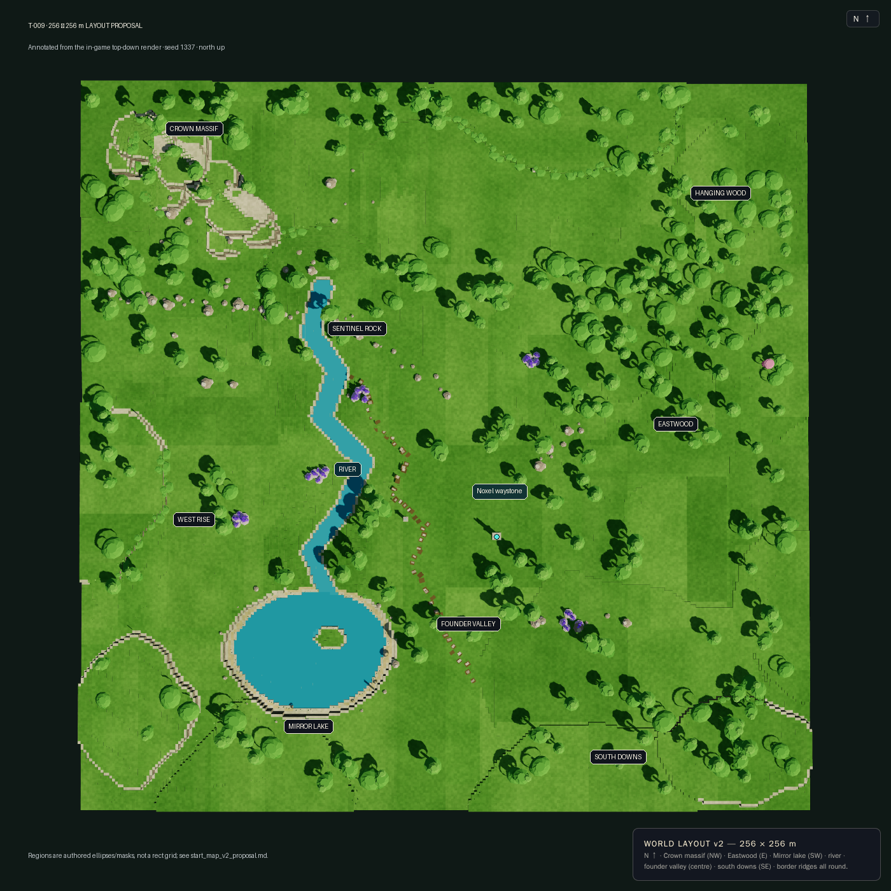

# start_map_v2 — 256 × 256 m layout proposal

**Status:** **PROPOSED — NOT APPROVED. GLM ratification required.**
**Date:** 2026-10-24 · **Author:** DeepSeek · **Owner for ratification:** GLM
**Supersedes for review:** `start_map_v1.json` (128 × 128 m). The v1 file remains the last formally
approved map until this proposal is ratified.
**Companion data:** [`start_map_v2_proposal.json`](start_map_v2_proposal.json)
**Implementation:** `Game/src/sim/world.ts` (seed 1337), `Game/src/render/terrain.ts`



*In-game top-down at `scene=map`, 1400×1400, with documentation labels added. The underlying render
is unchanged. North is up. The dark border is the map board; the world edge is the green square.*

---

## 1. Why 256 m

The 128 m v1 map compressed six named regions into a diorama: the lake, forest and massif competed
for the same screen, and the start plain felt like a stage. The 256 m candidate gives each region
room to connect:

- the founder valley has a real trail and a separate lake/river approach;
- Eastwood and the Hanging wood are woodland masses, not tree patches;
- the Crown massif has a talus skirt, a soft core and separate summit crags;
- the river can carry a floodplain and a lake delta;
- the border can use isolated mesas and passes rather than a retaining wall.

This is a **proposal**, not a retroactive approval. The review question is whether the larger world
still reads as one authored place and whether the added area is worth the triangle/prop budget.

---

## 2. Map specification

| Property | v2 proposal |
|---|---|
| Cells | 256 × 256 |
| Cell size | 1.0 m |
| Height quantum | 0.5 m |
| Sea level | 0.0 m |
| Foundation skirt | −12.0 m |
| Measured height range | −4.5 … 22.0 m (mean 4.77 m) |
| Playable camera-target clamp | ±120 m on x and z |
| Border ring outside the clamp | 8 m |
| Build grid | 2.0 m |
| Sim area | 65,536 m² |
| Render-only apron | 408 m radius, 12 m step |
| Horizon rings | 430 / 520 / 640 / 820 / 1,100 m |

### 2.1 Coordinates

- Cell indices `x = east (0..255)`, `z = south (0..255)`.
- Cell `(x,z)` covers world metres `[x−128, x−127) × [z−128, z−127)`.
- Cell centre: `worldX = x − 127.5`, `worldZ = z − 127.5`.
- World `x/z ∈ [−128, 128)`, `y` up, sea level `y = 0`.
- North is **negative z**.

The renderer and sim use the same cell grid. The 8 m border ring is inside the sim but outside the
camera's target clamp; border mesas and the foundation skirt occupy it.

---

## 3. Regions

| Region | Type | Centre (x,z) | Radii (rx,rz) | Height | Role |
|---|---|---|---:|---:|---|
| Founder valley | plain | 8, 36 | 31, 23 | 4.0 m | flat build shelf, trail, both Noxel test sites |
| Eastwood | forest | 76, −32 | 56, 46 | 4.5 m | principal eastern wood; two passes |
| Hanging wood | forest | 94, −74 | 34, 28 | 4.5 m | higher north-east wood |
| South downs | hills | 58, 80 | 48, 32 | 4.5 m | low downland and rim mesas |
| West rise | hills | −88, 38 | 38, 38 | 4.5 m | western upland and lake approach |
| Crown massif | highland | −88, −92 | 102, 74 | core 7 m; crags 11–22 m | broken north-west crown |
| Sentinel Rock | highland | −31, −25 | 9, 7 | 5.5 m | low grassy outcrop / orientation landmark |
| Mirror lake | water | −48, 72 | 29, 23 | water 0; bed −4.5 m | south-west lake, hard shore, reeds |
| Heron islet | water | −41, 68 | 6, 5 | 0.5–2.0 m | small wooded island |
| Border ridges | ridge | 0, 0 | 128, 128 | 4.5–8.0 m | eight isolated rim mesas and passes |

The ellipses are **authored masks**, not a literal rect grid. Most have a hard edge; only the massif
talus and the Sentinel skirt use a soft mask, so cliffs stay block faces rather than quantised cones.

### 3.1 Crown massif

- Six interlocking cores at **7 m** form one broken ridge, not nested terraces.
- Twelve separate crags at **11–22 m** break the table-top: `(−104,−106,22)`, `(−90,−96,20)`,
  `(−96,−100,19)`, `(−72,−80,18)`, `(−83,−91,17)`, `(−110,−100,16)`, `(−80,−92,16)`,
  `(−65,−75,15)`, `(−97,−87,14)`, `(−88,−104,13)`, `(−78,−71,12)`, `(−75,−90,11)`.
- Three talus fans at the eastern foot (`50,−12`, `66,−16`, `82,−20`) at 4.8 m.
- Three ravines cut the rims so the highland has saddles and traversal gaps.

The default view still reads as a blocky mesa/fortress. That is the primary open art question; the
crags help at closer range, but the review may require a further silhouette pass.

### 3.2 Water

**Mirror lake:** centre `(−48,72)`, radii `(29,23)`, bed `−4.5 m`, water `0 m`. The shoreline is a
hard blocky cut with a pale rim; reeds occupy the banks up to 2.2 m above water.

**River:** polyline from the massif south face to the lake:

```text
(−44,−56) → (−48,−40) → (−38,−26) → (−44,−10) → (−29,6)
          → (−36,22) → (−48,38) → (−41,54) → (−52,72)
```

Channel width 2.2–4.1 m, bed −1.7 m, banks 1.5 m, floodplain 18 m. The water surface is 0. The
shore is intentionally blocky; the bright bank courses can read as a canal and are flagged for
review.

### 3.3 Passes and routes

| Feature | Location | Purpose |
|---|---|---|
| East pass A | 66, −28 (15×11 ellipse, floor 4.0) | cuts the Eastwood shelf |
| East pass B | 100, −44 (11×9 ellipse, floor 4.0) | second route through the eastern wood |
| Massif ravines | three cuts listed above | breaks the highland rim; creates saddles |
| Founder trail | valley → lake approach | dark soil + occasional stone slabs; narrower than T-008 |

There is **no route-grade solver** in T-009. The trail is visual guidance, not a validated pathfinding
network. A future Task 013/020 pass should measure grades and traversal.

---

## 4. Resources and props

| Kind | Count | Placement |
|---|---:|---|
| Trees (woodland) | 260 | seeded shuffled 3.3 m lattice; first pass east/north, second pass remainder |
| Trees (solitary) | 48 | authored valley/forest-edge anchors |
| **Trees total** | **308** | 4 variants, scale 0.82–1.32 |
| Rocks | 97 | cliff feet, lake shore, forest edges |
| Ore | 28 | 5 veins: (−30,−18)×7, (−45,10)×6, (30,−30)×5, (44,62)×5, (−72,26)×5 |
| Noxel sites | 2 | waystone (18,32), marker (−14,26), both provisional |
| **Props total** | **433** | 308 trees + 97 rocks + 28 ore |

The v1 map specified 92 resource nodes. The v2 candidate has 433 scenic props; it is **not** a
resource-inventory implementation. Trees/rocks/ore are readable world material and future resource
hints, not a completed gathering loop.

---

## 5. What changed from `start_map_v1.json`

| v1 (approved baseline) | v2 proposal | Reason |
|---|---|---|
| 128 × 128 cells, playable rect 8..120 | 256 × 256, target clamp ±120 | room for connected regions |
| Rect region definitions | authored ellipse/mask landforms | avoids a rect-grid diorama; allows crags, passes, floodplain |
| Starting plain 16..54 × 80..102 | Founder valley ellipse (8,36) | centre the trail and Noxel test sites |
| One forest rect, 68 trees | Eastwood + Hanging wood, 308 trees | actual woodland masses |
| Massif rect at 86..128 × 0..20 | Crown massif ellipse + 12 crags + talus | mountain silhouette, not a terraced quarry |
| Lake ellipse at cell (76,91) | Mirror lake at world (−48,72) | south-west lake connected to river |
| River between massif and lake | stepped river + 18 m floodplain | natural join, blocky banks |
| 92 resource nodes | 433 scenic props (not inventory) | world readability; loop later |
| Height range −5..40 | −4.5..22 | lower crags, broader readable ridge |
| Budget 66,828 terrain tris | 245,094 total world tris | full props + horizon at 256 m |

The **height range dropped** from v1's 40 m observed summit to 22 m. The massif is now a broad broken
ridge with a 22 m crown, not a single 40 m spike. This was intentional: at default distance, a 40 m
spike read as a quarry wall. Whether 22 m is tall enough is a review question.

---

## 6. Boundary and performance

The boundary is not a floating box:

- the sim edge drops to a **−12 m foundation skirt**;
- a **408 m render-only apron** continues the border terrain at 12 m resolution;
- five **jagged horizon rings** at 430–1,100 m sit beyond the apron;
- the camera target clamps at ±120 m, so the player cannot walk onto the scenery;
- fog is present but is **not** the only boundary treatment.

Budget (unchanged: 120 calls / 250,000 triangles):

| Mode | Calls | Triangles |
|---|---:|---:|
| Default world | 49 | **245,094** |
| Top-down map | 50 | 201,670 |
| Noxel kit | 21 | 16,238 |
| Noxel close-up | 43 | 237,750 |
| Mobile 390×664 | 41–43 | 238,272–238,368 |

The default is **4,906 triangles under the cap (1.96 % headroom)**. Adding a region or a prop pass
requires reclaiming triangles first. Terrain shadows are disabled to protect the budget.

---

## 7. Ratification checklist

GLM must explicitly answer these; none is pre-approved.

- [ ] Accept **256 × 256 m** and the ±120 m camera-target clamp, superseding the 128 m v1 locally.
- [ ] Accept **authored ellipse/mask regions** instead of literal v1 rects.
- [ ] Accept the **height range −4.5…22 m**; the 40 m v1 summit is not restored.
- [ ] Accept the **308 trees / 97 rocks / 28 ore props** as a scenic stand-in, not a resource loop.
- [ ] Accept the **render-only apron + horizon** as scenery and the ±120 m clamp as the playable edge.
- [ ] Accept the **provisional Noxel waystone/marker** for the integration test only.
- [ ] Accept or reject **245,094 / 250,000 triangles**; if rejected, specify the prop reduction.
- [ ] Confirm whether the highland silhouette and bright river banks pass art review.

**If any box is unchecked, the map is not ratified and Task 004 remains blocked.**

---

## 8. Open questions for review

1. **Highland:** is the 22 m broken crown tall enough, or is the massif still a fortress? Would fewer,
   taller crags read better than twelve small ones?
2. **River:** are the hard banks a valid voxel edge, or do they read as a canal? If the latter, should
   the fix be value contrast, a wider floodplain, or a different shore rule?
3. **256 m:** does the larger map improve connection, or does it dilute the authored composition?
4. **Trees:** is 308 enough for Eastwood to read as a wood at default distance, or should the budget
   move from groundcover to trees?
5. **Noxel:** can the provisional kit be reviewed as a coexistence test without an owner reference?
6. **Budget:** is 1.96 % headroom acceptable for a candidate, or should the default target be ≤240k?

---

## 9. Reproduction

```bash
cd /home/ubuntu/as/Game
npx vite build
# static-serve dist on :8138, then:
cd /home/ubuntu/as/08_Technical_Director/Project_Setup
node tools/render.mjs "http://127.0.0.1:8138/?t=0.5&freeze=1&scene=map" map.png 1400 1400
```

The top-down panel in the build states the same region legend. The annotated image in
`13_Integration_and_QA/Evidence/T-009/` adds labels for review; it is documentation, not a second
render.

---

## 10. Status

**Proposed.** The running build is the evidence; this markdown/JSON is the layout contract to
ratify. It does not approve T-009, the 256 m size, the Noxel kit, or Task 004.
