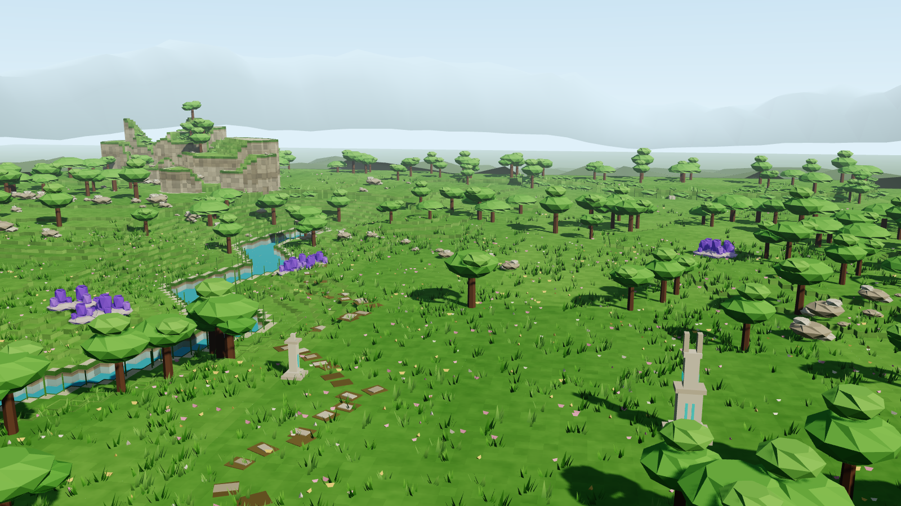
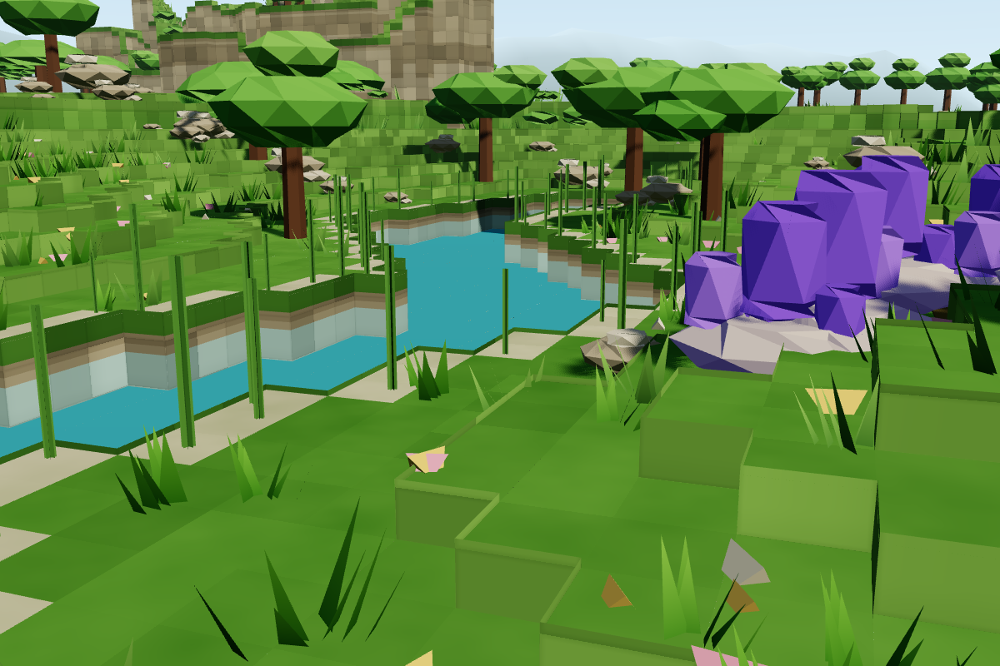
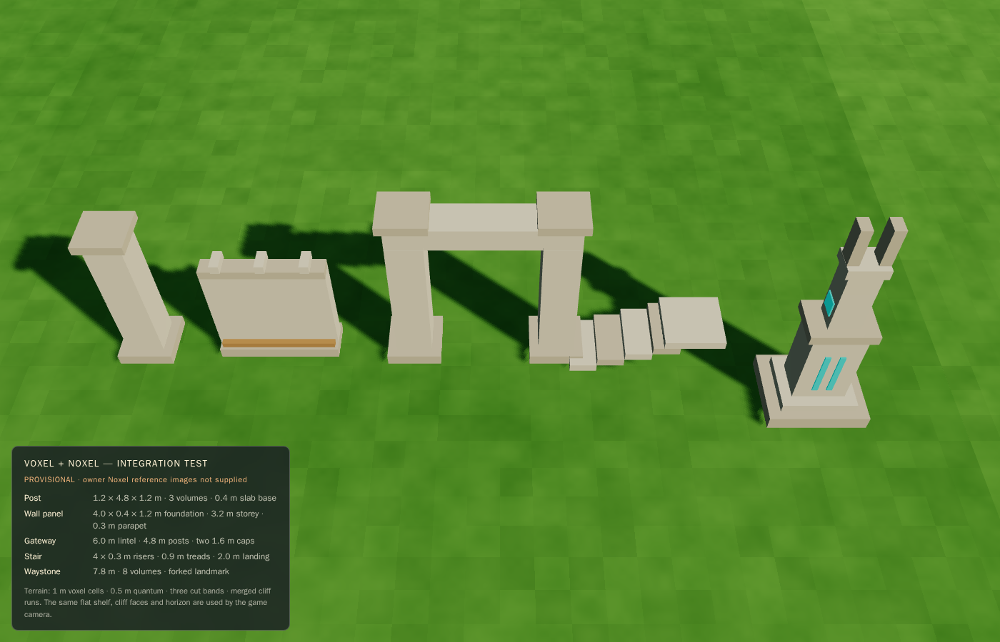
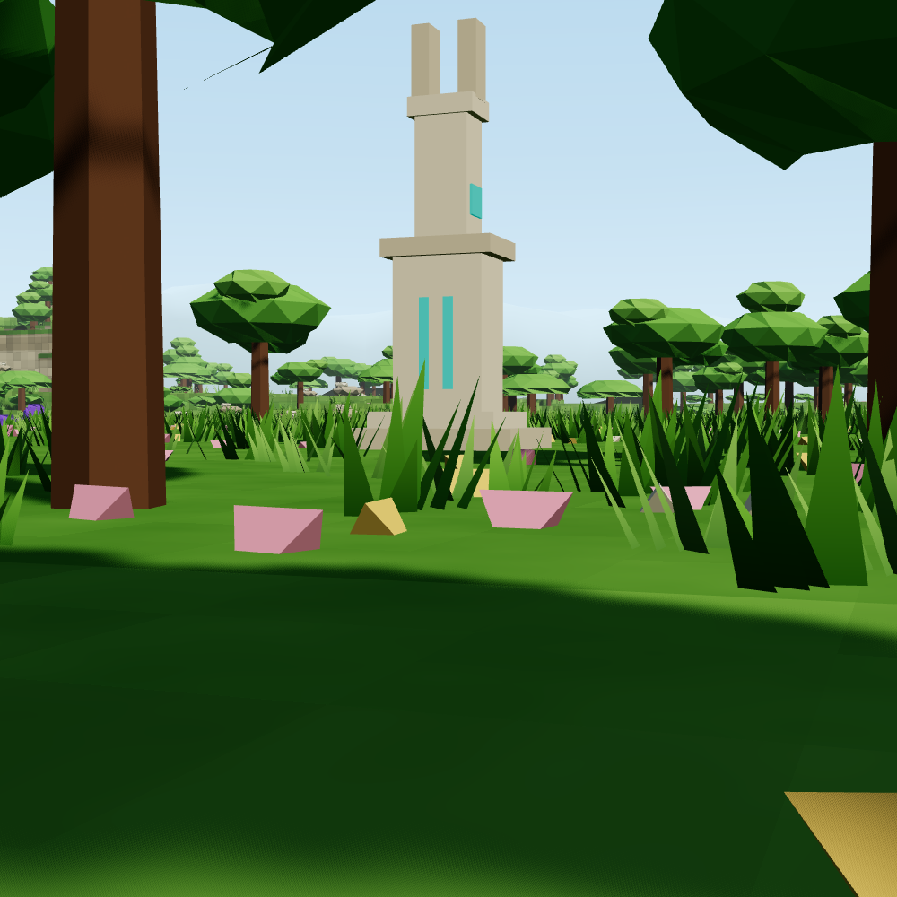
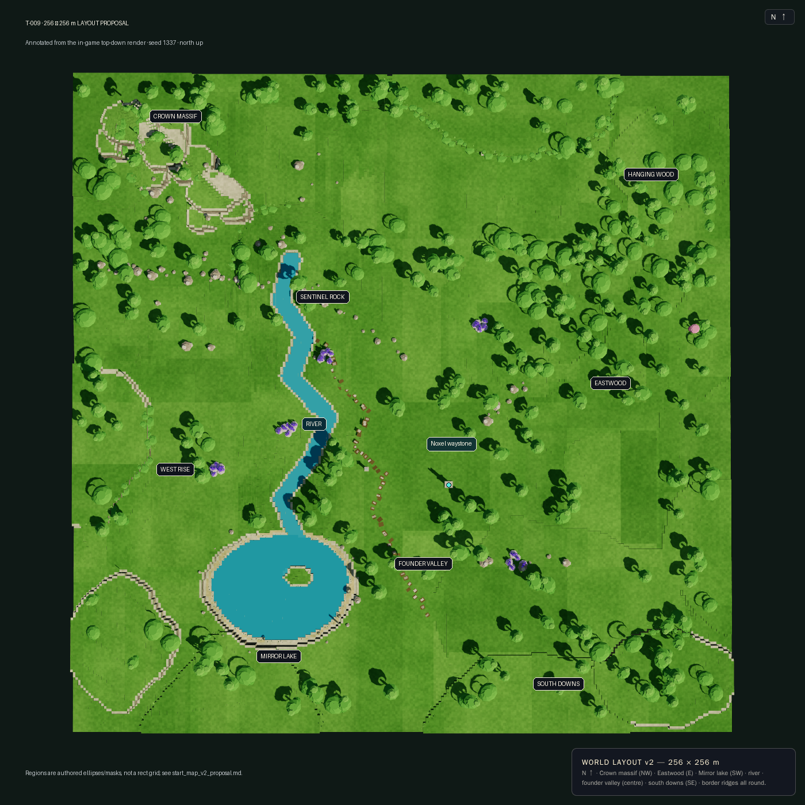

# IR-004 — Voxel world + provisional Noxel integration (T-009)

**Date:** 2026-10-24 · **Task:** 008 / T-009 · **Owner:** DeepSeek
**Status:** **Review Required — not approved.** Task 004 remains blocked.
**Build:** `Game/` (Vite + TypeScript + three r186), production build in `Game/dist`
**Public candidate:** <http://51.21.199.227/>

> T-008 (continuous heightfield, shader-only strata) was **not approved** and is superseded by
> this candidate. T-009 is also **not approved**. This report records what was built and measured;
> it does not grant approval.

**Review path (about five minutes):**

1. Open <http://51.21.199.227/> and drag/zoom for a minute.
2. Judge the voxel language on `T-009_world_voxel_closeup.png` (§4.1).
3. Judge coexistence on `T-009_noxel_kit.png` and `T-009_noxel_closeup.png` (§5).
4. Check the layout on `T-009_world_layout_annotated.png` (§6).
5. Answer the six questions in §13. Anything other than "yes" is a targeted fix, not Task 004.

---

## 1. What this candidate is

A 256 × 256 m playable voxel landscape, meshed from 1 m cells at a 0.5 m height quantum, with
connected authored regions and a small **provisional** Noxel presence. The purpose is to answer the
T-008 review questions with a real in-engine build:

1. Can the natural world read as *constructed voxels* at eye level, not as a smooth heightfield with
   painted bands?
2. Can voxels and Noxels coexist at the same scale without either language collapsing into the
   other?
3. Can a large landscape stay inside **120 draw calls / 250,000 triangles**?

The answer to (3) is measured below. The answers to (1) and (2) require human review.



*Default camera, 1600×900, seed 1337, noon. The trail, river, Eastwood, the Crown massif, one
waystone (right) and one marker (left of trail) are visible.*

---

## 2. What changed from T-008

| Area | T-008 (not approved) | T-009 candidate |
|---|---|---|
| World size | 128 × 128 m | **256 × 256 m**, playable camera target clamped to ±120 m |
| Terrain representation | continuous indexed heightfield | **1 m voxel cells**, greedy-merged tops, run-merged cut faces |
| Cliffs | smooth triangles with a strata fragment shader | real block faces with three geometry bands + world-space course/joint/stain shader |
| Landforms | authored but still read as concentric terraces in places | hard authored masks, separate crags, talus, passes, floodplain; no quantised smooth field |
| Props | 312 | 433 (308 trees, 97 rocks, 28 ore), 2 Noxel sites |
| Boundary | fog + thin horizon | foundation skirt + render-only coarse apron + multi-ring jagged horizon |
| Noxel test | none | kit sheet + two in-world landmarks, explicitly provisional |
| Modes | world | world, top-down map (`scene=map`), Noxel kit (`scene=kit`) |

The T-008 continuous-heightfield approach is retained only as history in IR-003. It is **not** the
current renderer.

---

## 3. Simulation data and world layout

The simulation is still pure TypeScript and has **no `three` import** (D-005). The renderer reads a
`World` containing heights, materials, flags, props and sites.

| Property | Value (seed 1337) |
|---|---|
| Cells | 256 × 256 (65,536) |
| Cell size / height quantum | 1.0 m / 0.5 m |
| Sea level / foundation skirt | 0.0 m / −12.0 m |
| Measured height range | **−4.5 m … 22.0 m** (mean 4.77 m) |
| Sub-sea cells | 2,437 (lake + river) |
| Materials | grass 61,304 · stone 3,536 · sand 696 · path 0 (trail is prop geometry) |
| Flags | shore 2,819 · cliff 1,001 · edge 2,032 · ore 28 |
| Props | **433** = 308 trees (260 woodland + 48 solitary) + 97 rocks + 28 ore |
| Noxel sites | 2 (waystone, marker) |

### 3.1 Regions

| Region | Type | Centre (x,z) | Radii (rx,rz) | Read |
|---|---|---|---|---|
| Founder valley | plain | 8, 36 | 31, 23 | flat build shelf at 4 m, trail, both Noxel sites |
| Eastwood | forest | 76, −32 | 56, 46 | dense eastern wood, clearings, two passes |
| Hanging wood | forest | 94, −74 | 34, 28 | higher wooded shelf on the north-east |
| South downs | hills | 58, 80 | 48, 32 | low rolling downland, border mesas |
| West rise | hills | −88, 38 | 38, 38 | western upland and the lake approach |
| Crown massif | highland | −88, −92 | 102, 74 | talus skirt, soft core, 12 separate crags at 11–22 m |
| Sentinel Rock | highland | −31, −25 | 9, 7 | low grassy outcrop, not a quarry block |
| Mirror lake | water | −48, 72 | 29, 23 | lake at water 0, bed −4.5, island |
| Heron islet | water | −41, 68 | 6, 5 | small wooded island |
| Border ridges | ridge | 0, 0 | 128, 128 | isolated rim mesas and passes, not a retaining wall |

The river is a stepped channel from the massif to the lake. It has an 18 m floodplain and 1.5 m
banks; the water surface stays at 0. Reeds populate the banks up to 2.2 m above water. This is a
deliberate hard blocky shore, following GLM's R9 shore pin, but the bright bank steps are a known
review risk (see §10).

The full layout proposal, including coordinates and ratification checklist, is
[`06_Voxel_Studio/Biomes/start_map_v2_proposal.md`](../../06_Voxel_Studio/Biomes/start_map_v2_proposal.md).
The 128 m `start_map_v1.json` remains the last formally approved map and is **superseded by
proposal, not by approval**.

---

## 4. Voxel construction and the voxel reference

The mesher in `Game/src/render/terrain.ts` does five things that matter visually:

1. **Greedy top faces.** Flat runs of equal height and material merge into large coherent quads, so a
   plateau is a plane rather than a grid of 1 m tiles. Material and height changes split the run.
2. **Run-merged cut faces.** A vertical face is emitted once per run (up to 4 cells before a break),
   not once per cell. This is the GLM §3.3 run-merge, applied to the voxel mesher.
3. **Three geometry bands.** Cut faces carry a grass cap, an ochre band and a rust/stone body.
   Bands are geometry, so they survive at any camera distance.
4. **A world-space terrain shader.** On top of the bands it adds 1 m courses, recessed joints,
   per-block tint, downward staining, grass mottling and per-cell grass variation. The result is
   meant to be read as **stacked blocks**, not as a smooth wall with a texture.
5. **Foundation skirt + scenery.** The sim ends at ±128 m; a 12 m skirt continues the edge down to
   y = −12, a 12 m-resolution outer apron continues the border mountains for hundreds of metres,
   and five jagged horizon rings sit beyond that. The apron and horizon are render-only and are not
   queried by the sim. The boundary is therefore a landscape edge, not a floating box; fog is not
   the only defence.

### 4.1 The voxel reference frame



*`T-009_world_voxel_closeup.png` — 1200×800. This is the frame to judge the voxel language on:
grass caps, exposed soil/stone, three-band cut faces, blocky water edge, ore and reeds.*

What a reviewer should be able to see in this frame:

- coherent 1 m cells at the bank and cliff edge;
- **grass on top, soil/stone on the cut**, not a single painted wall;
- stepped ledges and a non-uniform silhouette;
- ore hosted in the terrain, not floating;
- reeds and grass meeting the hard water edge;
- block scale that remains legible next to 1.7 m-scale trees.

Known weakness: the bank's pale stone/sand courses are brighter than the meadow and can read as a
canal lining at default zoom. The geometry is intentional; the value contrast is the open question.

---

## 5. Provisional Noxel integration

The owner's Noxel reference images are still absent from `05_Noxel_Studio/Reference_Images/`. The
Noxel kit therefore implements the **written** grammar only (rectangular prisms, axis-aligned, flat
colour, 4–9 volumes where applicable, 90° whole-asset rotation). It is **not** a final architecture
sheet and must not be used to unblock Task 004.



*`T-009_noxel_kit.png` — 1400×900, `scene=kit`. Post, wall panel, gateway, stair and waystone on a
flat voxel shelf. The panel lists dimensions and volume counts. The camera is a 3/4 view; the
waystone's apparent lean at the right edge is perspective, not rotated geometry.*



*`T-009_noxel_closeup.png` — 1000×1000. The 7.8 m forked waystone with teal inlays, framed by trees.
The shoulder hatch that appeared in earlier captures is gone after 1–2 cm volume overlaps and
disabling self-shadow reception on the prism meshes.*

Implementation details:

| Piece | Volumes | Height | Notes |
|---|---:|---:|---|
| Post | 3 | 5.5 m | 1.2 × 4.8 × 1.2 shaft, 0.4 m slab, 0.3 m cap |
| Wall panel | 7 | 4.2 m | 4.0 × 0.4 × 1.2 foundation, 3.2 m storey, 0.3 m parapet, 3 caps |
| Gateway | 7 | 6.3 m | 6.0 m lintel, 4.8 m posts, 1.6 m caps |
| Stair | 5 | 1.5 m | 4 × 0.3 m risers, 0.9 m treads, 2.0 m landing |
| Waystone | 8 | 7.8 m | forked crown; teal inlays and blue shoulder band |
| Marker | 5 | 4.0 m | in-world second site, 90° yaw |

The Noxel meshes are merged non-indexed boxes with one flat colour per volume, cast shadows enabled,
and **receiveShadow disabled** on the body. The body is simple prisms; self-shadowing only produced
acne on the large flat faces. The world terrain and props still receive shadows.

The kit is staged on a **kit-only flattened shelf**. The world generator is not changed; the render
entry point flattens a 34 m radius around the kit camera target only when `scene=kit`, so the near
valley step does not appear as a black tooth in the sheet. This is a test-scene treatment, not a
gameplay change.

The full provisional sheet is
[`05_Noxel_Studio/Asset_Sheets/AS-002_noxel_reference_sheet_provisional.md`](../../05_Noxel_Studio/Asset_Sheets/AS-002_noxel_reference_sheet_provisional.md).
It records the volume counts, dimensions, palette tokens, conformance gaps and the missing owner
references.

---

## 6. Evidence

All images are in-game captures from the running build, not concept art (D-010). Stable copies live
in `13_Integration_and_QA/Evidence/T-009/`.

| File | Size | Render | Calls | Triangles |
|---|---:|---|---:|---:|
| `T-009_world_default.png` | 1600×900 | world, noon, seed 1337 | 49 | **245,094** |
| `T-009_world_voxel_closeup.png` | 1200×800 | voxel bank close-up | — | — |
| `T-009_world_topdown.png` | 1400×1400 | `scene=map`, north up | 50 | 201,670 |
| `T-009_world_layout_annotated.png` | 1400×1400 | documentation overlay on the map | — | — |
| `T-009_noxel_kit.png` | 1400×900 | `scene=kit` | 21 | 16,238 |
| `T-009_noxel_closeup.png` | 1000×1000 | waystone in landscape | 43 | 237,750 |
| `T-009_time_dawn.png` | 1600×900 | t = 0.22 | 49 | 245,094 |
| `T-009_time_noon.png` | 1600×900 | t = 0.50 | 49 | 245,094 |
| `T-009_time_dusk.png` | 1600×900 | t = 0.78 | 49 | 245,094 |
| `T-009_time_night.png` | 1600×900 | t = 0.00 | 49 | 245,094 |
| `T-009_mobile_390.png` | 390×664 | touch UI, t = 0.50 | 41–43 | 238,272–238,368 |
| `T-009_public.png` | 1600×900 | deployed public URL, t = 0.50 | 49 | 245,094 |

The voxel close-up and the annotated layout are the only un-instrumented images; the close-up is
visual evidence and the layout is a documentation overlay. Every other capture, including all four
time presets and the mobile frame, was re-measured against the final shipped build.



*`T-009_world_layout_annotated.png` — the in-game top-down with hand-placed region labels. Labels
are documentation; the underlying render is unchanged. North is up.*

---

## 7. Performance

Budget: **120 draw calls / 250,000 triangles** (no change approved).

| Mode | Draw calls | Triangles | Headroom |
|---|---:|---:|---:|
| Default world, 1600×900 | **49** | **245,094** | 71 calls / **4,906 tris** |
| Top-down map, 1400×1400 | 50 | 201,670 | 70 calls / 48,330 tris |
| Noxel kit, 1400×900 | 21 | 16,238 | 99 calls / 233,762 tris |
| Noxel close-up, 1000×1000 | 43 | 237,750 | 77 calls / 12,250 tris |
| Mobile 390×664 | 41–43 | 238,272–238,368 | ≥ 11,632 tris |
| Public URL, 1600×900 | 49 | 245,094 | 4,906 tris |

The default view is **within budget but close to the triangle ceiling**. The margin is 1.96 %. Any
additional prop pass, denser groundcover, or larger tree budget must reclaim triangles first.
The map hides groundcover, horizon/apron and shadows; the kit hides all environment dressing. Those
modes are not evidence that the full world has more headroom.

Decisions that protect the budget:

- terrain `castShadow` is **disabled**; props/modules still cast;
- tree budget is 260 woodland + 48 authored solitary trees, not a uniform scatter;
- groundcover is capped at 4,800 tufts;
- top faces are greedy-merged and cut faces are run-merged;
- the map hides grass blades, horizon/apron, fog and shadows;
- the apron and horizon use coarse meshes outside the sim.

---

## 8. Determinism and layer rule

| Check | Result |
|---|---|
| Same seed (1337) twice | heights `51296949`, materials `a3087357`, flags `f0360f66`; 433 props; 2 sites — identical |
| Seed 42 | different height/material/flag hashes; 436 props; different site-independent scatter |
| `Math.random` in `src/sim` | none |
| `three` import in `src/sim` | none |
| `vite build` | passes; production bundle in `Game/dist` |
| Console / page errors | 0 in every captured mode |

The render harness exposes only `window.__probe.renderer` in the shipped build. `world`, `THREE`,
scene graph, sim data and the `shadows` debug parameter were removed before submission.

---

## 9. Controls, time and mobile

- Mouse: drag orbit, wheel zoom, WASD/arrows move, Q/E yaw, `+`/`-` zoom, Shift sprint.
- Time: space pause; `1` dawn (0.22), `2` noon (0.50), `3` dusk (0.78), `4` night (0.00).
- Touch: five-pad D-pad plus zoom in/out on coarse pointers; one-finger orbit, two-finger pan/zoom.
- URL: `?t=0..1&freeze=1&seed=N&yaw=&pitch=&dist=&tx=&ty=&tz=&scene=world|map|kit&ui=0`.

Mobile verification at **390 × 664**, iPhone UA, touch enabled:

| Check | Result |
|---|---|
| `(pointer: coarse)` / touch points | true / 1 |
| Controls display | `flex`; 5 pads + 2 zoom buttons |
| HUD position | bottom offset 142 px; no overlap with controls |
| Horizontal overflow | none (`scrollWidth` = 390) |
| Held forward pad 0.9 s | camera moved; before/after frames differ |
| Errors | 0 |
| Triangles / calls | 238,368 / 43 initial; 238,272 / 41 after a 0.9 s forward hold |

The four time presets were re-captured at the default camera against the final build (49 calls /
245,094 triangles each). Dawn and dusk remain legible; night is deliberately nocturnal and relies
on the moon key plus the Noxel teal inlays. It is the least legible preset and should be judged by a
human before being called final.

---

## 10. Defects found and fixed

1. **Inverted top/water winding** — faces were culled; fixed by deriving winding from normals.
2. **Hairline seams** — adjacent quads left pixel cracks; fixed by shared heights and flatter
   overlapping edges.
3. **Floating rock/ore/bush geometry** — props sat at the wrong height on slopes; fixed by sampling
   terrain at each prop footprint and embedding the base.
4. **Low-bank grass sides** — low banks got stone strata; restricted to low grass/soil faces.
5. **Empty Eastwood on the map** — row-major tree placement spent the budget in the north; replaced
   with a seeded shuffled lattice, then a two-pass eastern/northern fill.
6. **Tree masses too uniform** — added authored solitary trees and clearings; 308 total.
7. **Canal-like trail** — replaced the wide trail with a dark-soil base and occasional stone slabs,
   narrower and more meandering.
8. **Noxel shoulder hatching** — coplanar contacts caused depth fighting; volumes now overlap by
   1–2 cm; self-shadow reception disabled on the body.
9. **Waystone clipped in the kit** — camera retargeted and the stair moved left; all five pieces fit.
10. **Map cropped at the border** — map camera distance raised to 460 m; world now fits with margins;
    north arrow added.
11. **Black tooth in the kit corner** — a 0.4 m valley step sat in the near corner; kit-only flat
    shelf added; no gameplay change.
12. **Stair landing gap** — the 2.0 m landing was placed 0.7 m beyond the last tread; moved to
    z = 3.6 m so it sits at the top of the fourth riser. The kit layout was respaced to keep the
    landing clear of the waystone plinth.
13. **Waystone joint rule** — the first overlap pass used 1–2 cm seats, below the style guide's
    0.05 m minimum. Reworked to 5 cm seats without changing the silhouette.

---

## 11. Known issues and review risks

- **Highland silhouette.** At the default camera the Crown massif still reads as a blocky mesa or
  fortress. The 12 separate crags and talus help at closer range, but the default view does not yet
  say "mountain" unambiguously. This is the main art-direction question.
- **River banks.** Hard blocky banks are deliberate and GLM-consistent, but the bright stone/sand
  courses can read as a canal. The geometry should not be softened without a style decision; the
  value contrast is the likely fix.
- **Noxel provenance.** No owner reference images. The kit is spec-conformant only in the written
  grammar and must not be treated as final architecture. The waystone/marker are **provisional**.
- **256 m is not ratified.** It supersedes the approved 128 m `start_map_v1.json` and needs GLM
  ratification. Until then, the map is a proposal.
- **Triangle headroom is thin.** 245,094 / 250,000. A small prop addition can breach the cap.
- **Terrain shadows are off.** This is a budget decision. Enabling them would change the look and
  likely exceed the cap; it needs a measured pass, not a guess.
- **Palette copy.** `Game/src/data/palette.json` is still a manual copy of the authoritative palette.
  A sync check is not implemented.
- **No GPU colour check.** Captures use SwiftShader; final tone should be checked on a real GPU.
- **No gameplay loop.** This is a world/art candidate, not a game. Task 004 and the settlement loop
  remain out of scope.

---

## 12. Deviations from the approved spec (documented, not hidden)

| Deviation | Reason | Status |
|---|---|---|
| 256 × 256 m instead of 128 × 128 m | 128 m compressed the named regions into a diorama; 256 m gives connected valley/forest/highland/lake/passes | **Proposed**; needs GLM ratification |
| Authored ellipse/mask landforms instead of literal `start_map_v1` rects | Keeps regions connected and avoids a rect-grid diorama; resource counts differ | Proposal (v2) |
| 433 props instead of the v1 92-node resource list | Trees/rocks/ore are scenery + resource hints; a full inventory loop is later | Documented |
| Voxel mesher instead of T-008 continuous heightfield | T-008 was not approved; voxel construction was the review requirement | Candidate; not approved |
| Terrain shadows disabled | Budget (245k already near 250k) | Measured; needs art acceptance |
| Noxel kit custom pieces (post 3 volumes, wall panel 7) | Written grammar, not the catalog's literal wall/post pieces; owner images absent | Provisional |

---

## 13. Review gate

This is a **review candidate**, not an approval. A human reviewer is asked to decide:

1. **Voxel construction:** does the eye-level frame (`T-009_world_voxel_closeup.png`) read as
   coherent 1 m voxels with grass caps and exposed strata, rather than a smooth heightfield?
2. **Highland:** is the blocky mesa/fortress silhouette acceptable, or must the crags be broken up
   further / the massif lowered before Task 004?
3. **River:** do the hard banks read as authored stone, or as a canal? If the latter, is the fix value
   contrast, bank width, or a different shore rule?
4. **Noxel coexistence:** does the kit/waystone coexist at the same scale without looking like a
   Minecraft import? Remember the kit is **provisional** because the owner references are missing.
5. **256 m:** does GLM ratify the new dimensions and layout, or require a return to the 128 m
   baseline?
6. **Budget:** is 245,094 / 250,000 acceptable for this candidate, or must props/groundcover be
   reduced to create a larger review margin?

If any answer is "no", the next move is a targeted art/geometry pass — **not** Task 004 and not a
hero illustration. Task 004 stays blocked until this report is reviewed and the voxel + Noxel
coexistence is accepted.

---

## 14. Reproduction

Local:

```bash
cd /home/ubuntu/as/Game
npx vite build
# serve dist on :8138 (any static server)
```

Captures:

```bash
cd /home/ubuntu/as/08_Technical_Director/Project_Setup
node tools/render.mjs "http://127.0.0.1:8138/?t=0.5&freeze=1&ui=0" out.png 1600 900
node tools/render.mjs "http://127.0.0.1:8138/?t=0.5&freeze=1&scene=map" map.png 1400 1400
node tools/render.mjs "http://127.0.0.1:8138/?t=0.5&freeze=1&scene=kit" kit.png 1400 900
```

The harness waits for `window.__ready`, screenshots, reports `renderer.info.render` and fails on
console errors. It is a manual tool, not CI.

---

## 15. Bottom line

The world now demonstrates the requested **voxel + Noxel coexistence in-game** at 256 m, with a
measured 245,094 triangles / 49 draw calls and deterministic, render-agnostic simulation data.
It also still has two honest art risks — the highland silhouette and the river-bank read — plus a
**provisional** Noxel kit with no owner references. It is ready for human review, **not approval**.
